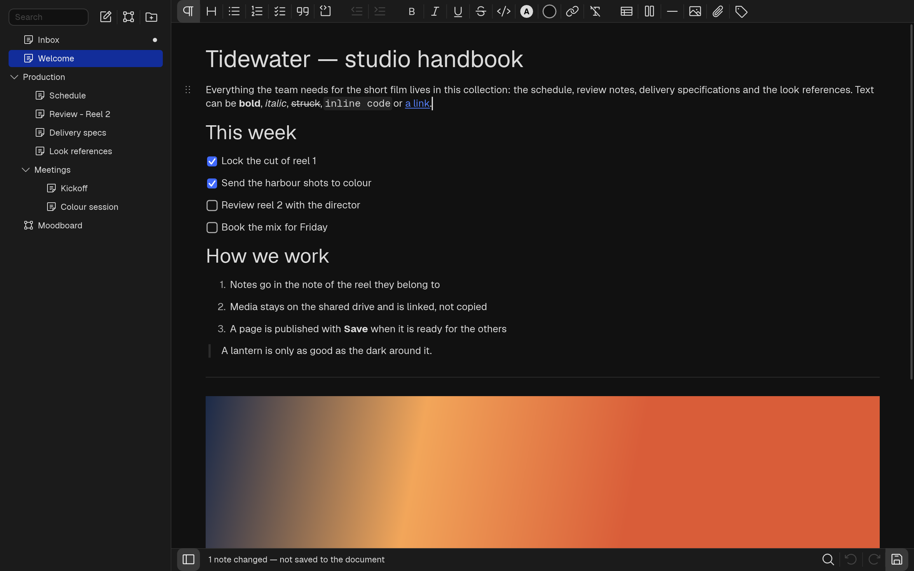

# minNotes

**minNotes** is a notes editor for macOS and Windows for people who work with footage: notes with pictures, video,
PDFs and tables in them, canvases to lay them out on, and exports that others can read in a browser.

Manual: **[minnotes.app](https://minnotes.app)**

## Download

### Windows

### macOS

A signed and notarized `.dmg` is on [GitHub Releases](https://github.com/cbkow/minNotes/releases/latest). It needs
macOS 13.0 (Ventura) or later on Apple Silicon. minNotes updates itself from there on.

## What is in this repository

This repository is minNotes' home page: the manual, the releases and the update feed. The application's source code is
elsewhere.

| | Where |
|---|---|
| **minNotes 3 source code** | [cbkow/minplatform](https://github.com/cbkow/minplatform) (`apps/mn`) |
| **minNotes 2 source code** | the [`2.x` branch](https://github.com/cbkow/minNotes/tree/2.x) of this repository |
| The manual and the site (minnotes.app) | [`docs/`](docs/) |
| The macOS update feed | [`docs/appcast.xml`](docs/appcast.xml); a release's entry is made by `packaging/macos/appcast-minnotes.sh` in minplatform |
| Installers | [Releases](https://github.com/cbkow/minNotes/releases) |

minNotes 3 is a new application, written in Rust on wgpu beside [QCView 3](https://github.com/cbkow/QCView-Player). It
replaces minNotes 2 (Qt Quick / QML) in place. A minNotes 2 document is not opened as it is: minNotes 3 **imports its
pages** into a new collection and leaves the old file unchanged. Read
[Coming from minNotes 2](https://minnotes.app/from-2/) before you update.

On Windows the Microsoft Store is the only place minNotes comes from, and the Store delivers its updates.

## Documentation

- [Manual](https://minnotes.app/)
- [Privacy Policy](https://minnotes.app/privacy/)
- Third-party notices: in the application, **minNotes > Licenses...** on macOS and **Help > Licenses...** on Windows;
  an overview is on the [Licenses & Credits](https://minnotes.app/licenses/) page; their source is in
  [minplatform](https://github.com/cbkow/minplatform)

## License

minNotes is free software released under the **GNU General Public License version 3**. See [LICENSE](LICENSE) for the
full text. The complete corresponding source of minNotes 3, including its build scripts and third-party notices, is at
https://github.com/cbkow/minplatform.

Copyright (c) 2025-2026 cbkow.
