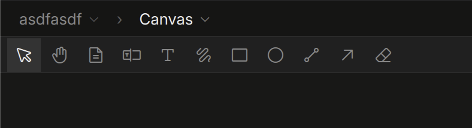
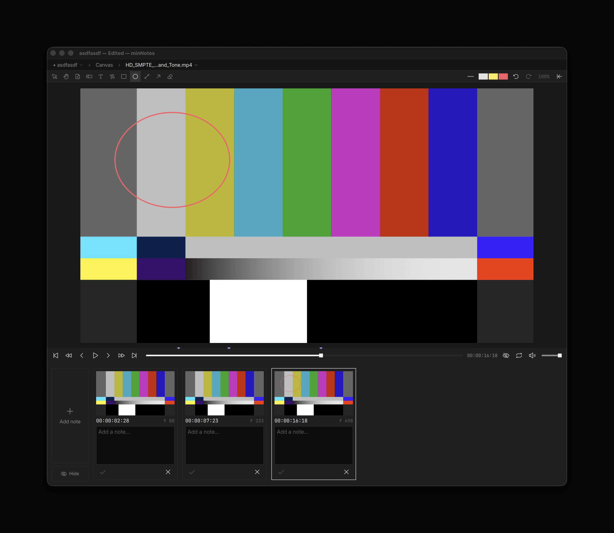

# Drawing & Video

Drawing lives on the **canvas**. The canvas toolbar holds the pen, line,
arrow, rectangle, oval, text box, plain text and eraser tools, each on a
single key; strokes are canvas elements you can select, move, restyle and
reorder like anything else. The [Canvas](canvas.md#drawing) page has the
tools and keys.

Pick a tool and draw; `Esc` drops back to the pointer. Zoom in for
detail — strokes keep their width in canvas units, so a fine line at 200%
is still fine at 50%.

> Coming from 1.x: ink that was pinned to text or page margins now sits on
> the canvas beside the page it belonged to, and sketch blocks become ink
> and chips beside the page. Nothing is lost in the conversion; it is
> simply no longer attached to the text.

## PDF Pages

A PDF opens full-window from its card, its inline block, or the path bar.
Pages scroll, zoom with the usual keys, and the frame segment switches
between the page's PDFs. Markup made on PDF pages in 1.x stays with the
PDF — it shows on the inline preview, on the canvas card, in the PDF's
frame, and exports as marked-up page images. The PDF file itself is never
touched.

## Video

Open a video full-window for the review studio: scrub with skim audio,
step frames, and draw on any frame. Annotations save to a `.qcview`
sidecar next to the media — **fully interchangeable with QCView**: notes
made in either app open in the other. The same transport works on an
inline video block that has the caret and on a selected video card on the
canvas.

| Action | Shortcut |
|---|---|
| Play / pause | `Space`, `K`, `W` or `S` |
| Step a frame back / forward | `←` / `→` (or `Q` / `E`) |
| Rewind / fast-forward (hold) | `J` / `L` (or `A` / `D`) |
| Start / end | `Home` / `End` |
| Cycle review speed (0.5×–2×) | `R` |
| Reset speed | `⇧R` |
| Loop | `V` |
| Mute · volume | `M` · `↑` / `↓` |

Every counter shows **timecode**; click it to flip all players to frames.

A clip's notes can come into the document as blocks: **Insert notes
below** on an inline video's block menu writes them under the video, each
note a marked-up frame with its timecode and text; **Notes as a page
below** on a canvas video card writes them to a new page under the card.

## Streams

Notes QCView takes on a live feed (a Premiere Pro or After Effects
sequence over QCBridge, or an SRT stream) have no clip behind them: they
live in the QCView project, in `.qcview/streams/<stream>/`, each with the
frame it captured and the time it was taken. QCView's **Open in minNotes**
hands that folder here; so does opening the folder (or its `notes.json`)
with minNotes, or dropping the folder on a canvas and choosing **Open as
stream** from its card.

The first open creates a file beside the notes with every note already in
it — the captured frame as an image block carrying QCView's strokes, then
a line with the capture time, the host's timecode when the feed carries
one, and the note's text. The file is yours from there: edit, reorder,
export. The stream chip in the toolbar keeps the folder in view; as QCView
adds notes to the stream, **Insert notes** brings the folder's notes in
again as blocks at the end of the page.
