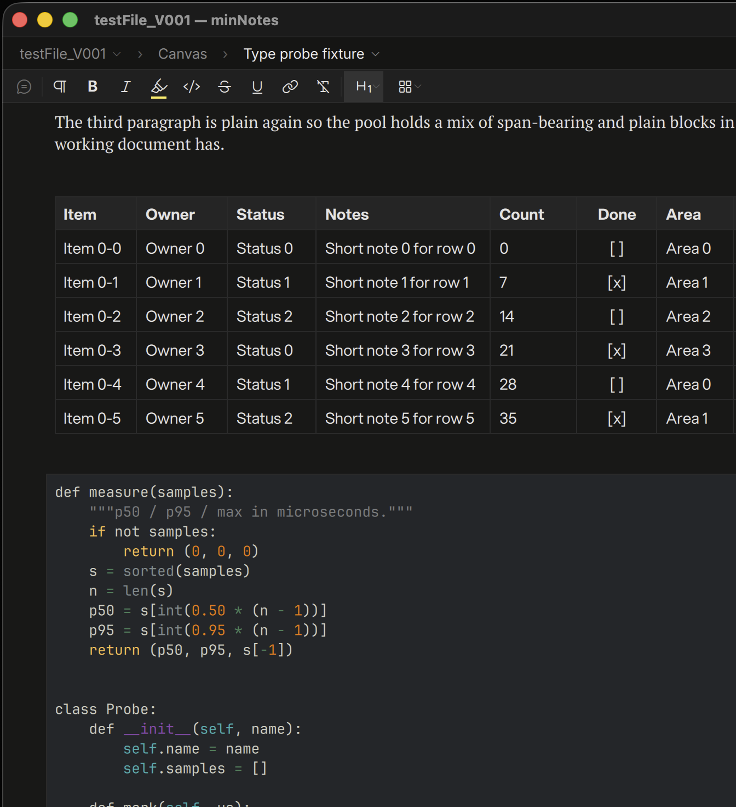
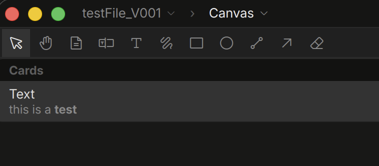
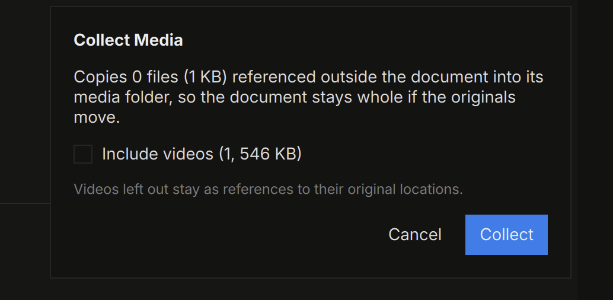

# Files & Pages

A file is a single `.mnd` — one **canvas** holding any number of
**pages**. Keep it on local disk, a NAS share, Dropbox, LucidLink —
anywhere — and open it from macOS or Windows.

A new file opens on its first page, ready to type. Press `Esc` with nothing
selected to step out to the canvas; double-click a page there to get back
in. The [Canvas](canvas.md) page covers everything that happens on the
canvas; this one covers files.

## The Path Bar

The strip above the toolbar reads like a path: **File › Canvas › Page ›
Frame**.

- The **file name** is the switcher. Click it for every open file, **+ New
  file**, and a close box per file. A dot before the name marks unsaved
  changes.
- **Canvas** takes you to the canvas.
- The **page** segment names the page you are in; click it for the
  file's other pages, **+ Add page**, and this page's tables, videos and
  PDFs.
- The **frame** segment appears while a table, video or PDF is open
  full-window; click it to switch between them.

Click any segment to the left to go up a level. **New** (`⌘N`), **Open**
(`⌘O`), **Save As** (`⌘⇧S`), and **Close** (`⌘W`) live in the File menu.
Closing a file or quitting with unsaved work prompts you first.

## Search

`⌘F` (**Edit ▸ Find in File…**) opens a search field under the toolbar.
It searches the **whole file**: every page's text, the cards on the canvas
(file names and paths, link titles and addresses, folder entries, text
chips), the text inside every PDF, each video's QCView notes, and comment
threads. Hits group by source with the current page's first; a snippet
shows each match. `↑` / `↓` walk the list and `Return` jumps: a page hit
opens the page with the match selected, a card hit selects it on the
canvas, a PDF hit opens that page, a video note opens the studio at that
frame. `Esc` closes the search, from the field or from the page, before it does
anything else. A PDF's text is read once, the first time you search
after adding it, and kept in the file.

<!--  -->

## Saving

minNotes edits a fast local working copy of your file and writes back to
the original when you **Save** (`⌘S`). This keeps files safe even on
network shares that don't play well with live databases. If the file
changed on disk while you worked (another machine, another person), Save
tells you before overwriting.

## Opening 1.0 files

A file written by minNotes 1.x opens as a canvas with one page holding
the whole document. Margin ink becomes ink beside the text, sketches become
ink and chips beside the page, PDF page markup stays with its PDF. The
converted file opens **read-only** with a toast describing what moved;
**Save As** writes a 2.0 file and the original is never touched. minNotes
1.x cannot open 2.0 files.

## Merging Files

**File ▸ Merge File Into This Page…** copies another open file's pages
into the page you are editing, at the end. The block menu's **Merge a
file here…** does the same at a chosen spot. Text, tables, media and
comment threads (with their history) all come along; one `⌘Z` undoes the
merge. To bring in a file that is not open, drop its `.mnd` or `.mnpkg`
on the canvas — its pages copy in as pages, arranged as they were.

## Save As & Media

**Save As** copies the file and its media folder to the new location. If
media is still referenced from elsewhere (a NAS share, an absolute path),
minNotes offers to **collect** it into the new file so the copy is
self-contained:

Videos are opt-in (they're big). Decline and everything stays linked —
you can collect later with **Document ▸ Collect Media…**. See
[Media](media.md).

## Recent Files

**File ▸ Open Recent** lists your last ten files. The welcome screen (no
file open) offers the same list, plus drag-and-drop import.
