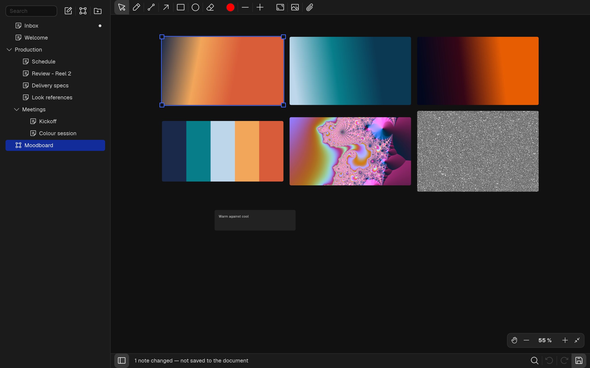
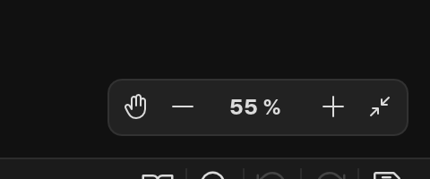
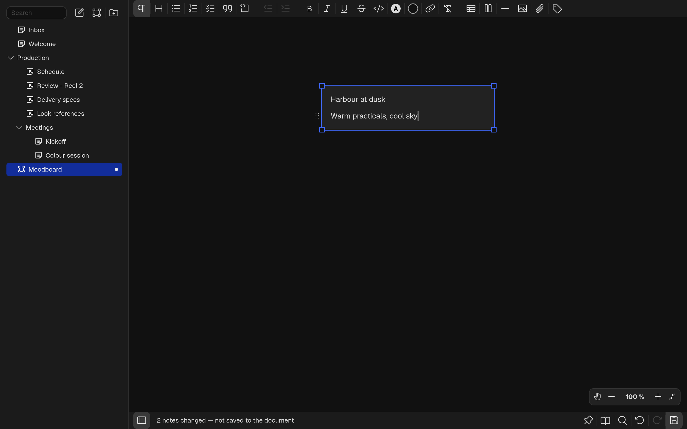
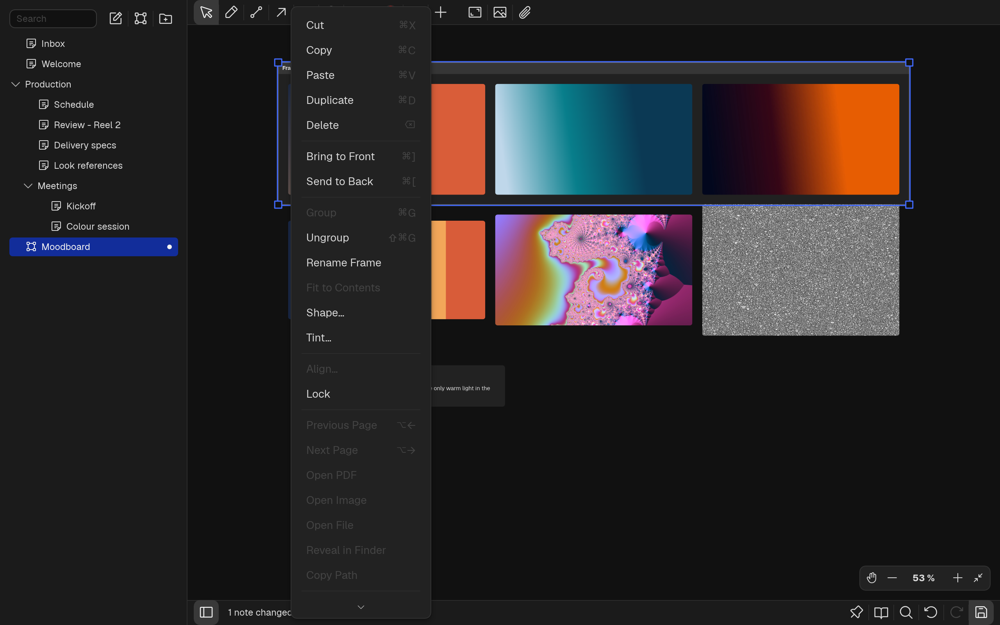

# The Canvas

A canvas is a boundless sheet for laying things out: pictures, videos,
PDFs, files, links, notes and drawings, placed where you want them. Use it
for a moodboard, a wall of references, a review board.

A canvas is an entry of the collection's tree, beside the notes and
folders. A collection can have as many as you like, or none.

## Making and Opening a Canvas

Click **New canvas** in the sidebar's header. The canvas appears in the
tree; rename, move and delete it there like a note.

Click a canvas's row to open it in the page's place. Each canvas remembers
where you were looking. Until you move the view yourself, it follows the
content and keeps everything in sight.

To change a canvas, the window must be in editing. In reading a drag
moves the view, and nothing is moved, resized, drawn or entered. A click
on a card still chooses it, so that you can use it:

- a video card shows its strip and the row of its notes: play, scrub and
  go to a note's frame with the pointer;
- a PDF card's pages turn with `Option+Left` / `Option+Right`
  (`Alt+Left` / `Alt+Right`) or **Previous Page** / **Next Page**; the
  page shown is not a change to the canvas;
- the card's menu keeps **Copy**, **Open File**, **Reveal in Finder** /
  **Show in Explorer**, **Copy Path**, **Open PDF** and **Open Image**.

Press `Cmd+R` / `Ctrl+R`, or the book button in the footer, to edit; a
canvas you have just made is in editing. See
[Reading and Editing](collections.md#reading-and-editing).

A canvas has its own undo history: `Cmd+Z` / `Ctrl+Z` and `Shift+Cmd+Z` /
`Ctrl+Shift+Z` step through what was done on this canvas.

## The Toolbar

While a canvas is open the toolbar shows the canvas's tools:

| Tool | Key | What it does |
|---|---|---|
| Select | `V` or `Esc` | Selects and moves things |
| Pen | `P` | Draws freehand. A tablet's pressure varies the line |
| Line | `L` | A straight line |
| Arrow | `A` | An arrow |
| Rectangle | `R` | A rectangle |
| Oval | `O` | An oval |
| Eraser | `E` | Rubs out what it passes over |
| Pen colour | | The colour of new ink, or of the selected ink |
| Thinner line / Thicker line | | The width of new ink, or of the selected ink |
| Frame | `F` | Click for a frame that hugs what is put in it, drag for one with a size of its own |
| Add pictures, videos or PDFs | | Opens the system's dialog |
| Add files | | Opens the system's dialog |

Press a tool's key again to put it down.

## Moving Around

**Pan**

- Scroll with the wheel or two fingers. `Shift` + wheel goes sideways.
- Hold `Space` and drag.
- Drag with the middle button.
- Turn on the hand in the zoom box, then drag.

**Zoom**, from 5 % to 400 %

- Pinch.
- `Cmd` + wheel / `Ctrl` + wheel zooms about the pointer.
- The keys in the table below.
- The zoom box.

The **zoom box** stands at the canvas's lower right. It needs no modifier
key and no pinch, which helps over a remote desktop. From left to right:
the hand (**Pan**), minus (**Zoom out**), the percentage (click it for
100 %), plus (**Zoom in**) and **Fit everything**.

| Action | macOS | Windows |
|---|---|---|
| Zoom in / out | `Cmd+=` / `Cmd+-` | `Ctrl+=` / `Ctrl+-` |
| Fit everything | `Cmd+0` | `Ctrl+0` |
| 100 % | `Shift+Cmd+1` | `Ctrl+Shift+1` |

Seen from far out, a card is drawn as its bare box.

## Putting Things on the Canvas

**Files.** Drop them from the Finder or Explorer, paste them, or use the
toolbar's two add buttons. They become cards of the same kinds as the
blocks of a note, and are linked or kept by the same rules: see
[Media & Drawing](media.md). An empty canvas says so: "Drop pictures,
videos, PDFs or files here — or double-click to type".

**A picture from the clipboard.** `Cmd+V` / `Ctrl+V` makes a picture card.

**Text.** Double-click the empty sheet and type, or paste text. This makes
a note that belongs to the canvas.

**A link.** Paste a web address. It becomes a link card.

**A note of the collection.** Drag the note's row from the sidebar onto
the canvas, or right-click the sheet and choose **Add Note…**.

## The Cards

### Pictures

Double-click a picture, or select it and press `Return` / `Enter`, to look
at it larger: the view goes to the card. `Esc` steps back to where you
were (after a double-click, the first `Esc` leaves the card and the second
returns the view).

For the picture alone across the whole window, with zoom and the drawing
tools, right-click the card and choose **Open Image**. See
[The Large View](media.md#the-large-view).

### Videos

Select a video card and a strip appears under it: play, the timecode, and
the line to scrub on. Press `Space` to play and pause, in the card, at any
zoom. While one video card is selected, the keyboard is the same transport
as in a note (the table is on [Media & Drawing](media.md#video)), and the
drawing tools' letters wait until you deselect it.

One video plays at a time across the whole window. A video that leaves the
view, or is seen from far out, stops.

When the clip has review notes, the selected card shows the row of their
small pictures under the strip. Click one to go to its frame; click it
again to edit its words. The notes' marks are on the scrub line, and the
note's drawing and words show over the picture on its frame.

While you watch, scrub or draw, the card's outline and corners stay out of
the way. Click the card's picture to bring them back and resize it.

### PDFs

A PDF card shows one page. With the card selected, turn the page with
`Option+Left` / `Option+Right` (`Alt+Left` / `Alt+Right` on Windows), or
**Previous Page** / **Next Page** in the menu.

**Open PDF** in the menu shows the whole PDF across the window: every
page in a scrolling column, a strip of small pages, zoom, text you can
select and copy, and find through all pages. See
[The Large View](media.md#the-large-view).

### Files and Links

A file's card is the same chip as in a note: icon, name, size. Double-click
it to open the file in its own application. Double-click a link card to
open the address.

### Notes

There are two kinds of note card, and they work the same way:

- **A note of the canvas's own**, made by double-clicking the sheet or
  pasting text. It lives with the canvas and has no row in the tree. To
  make it an ordinary note of the collection, right-click it and choose
  **Promote to Note**.
- **A note of the collection**, dragged in from the sidebar. The card is
  the note itself, live: edit it in either place. One note can be on
  several canvases. Removing the card never deletes the note. If the note
  is deleted from the tree, its card says "Note deleted".

To **edit** a note card, double-click it, or select it and press `Return`
/ `Enter`. The view goes to the card at 100 % and the note's own editor
works inside it, with the text toolbar and everything a note can do. A
note longer than its card scrolls inside it. `Esc`, or a click outside,
leaves the card.

To open the note in the page instead, select the card and press
`Cmd+Return` / `Ctrl+Enter`, or choose **Open Note** in the menu.

## Drawing

Pick a drawing tool and draw on the sheet. Each stroke is a thing of its
own on the canvas.

- The **pen** uses the pen colour and a width from 1 to 64. Both are
  remembered, and shared with the drawings you make on media.
- Hold `Shift` to keep a line or arrow to the eight directions, and to
  make a rectangle square or an oval round.
- The **eraser** rubs: a pen line loses the part the eraser passes over
  and the rest stays. A shape goes whole. One drag is one undo step.
- `Esc` gives up the stroke you are drawing; pressed again, it puts the
  tool down.
- Hold `Space` to pan while a tool is armed.

A stroke is not selected after you draw it, so the next one can follow.
To change one later, switch to Select and click on its line. Then move it,
delete it, or give it another colour or width with the toolbar.

**Drawing on a card.** Ink drawn over a card stays the canvas's own: it
floats above the card. To draw **on** a picture, a PDF page or a video
frame, double-click the card first to enter it, then draw. That ink
belongs to the picture or page, as it does in a note; on a video it is a
review note on that frame, written beside the clip for QCView.

The same holds in the large view (**Open PDF**, **Open Image**): what you
draw there is written to the card's picture or page, as one step of the
canvas's undo history.

## Selecting and Arranging

| Action | How |
|---|---|
| Select | Click a card. `Shift` + click adds or removes one |
| Select several | Drag a marquee from the empty sheet |
| Select everything | `Cmd+A` / `Ctrl+A` |
| Move | Drag. `Shift` keeps the move to one axis |
| Nudge | Arrow keys move by 1; with `Shift`, by 10 |
| Resize | Drag a corner of the one selected card. A picture keeps its shape; `Shift` keeps any card's proportions |
| Delete | `Delete` or `Backspace` |
| Copy / cut / paste | `Cmd+C` / `Cmd+X` / `Cmd+V` (`Ctrl` on Windows) |
| Duplicate | `Cmd+D` / `Ctrl+D` |
| Bring to Front / Send to Back | `Cmd+]` / `Cmd+[` (`Ctrl+]` / `Ctrl+[`) |
| Deselect | `Esc` |

**Snapping.** As you drag or resize, a card's edges and centre snap to
those of the other cards in view, and a thin line shows where. Hold `Ctrl`
to move freely.

**Align and distribute.** With two or more cards selected, right-click and
choose **Align…**: **Align Left**, **Align Centre**, **Align Right**,
**Align Top**, **Align Middle**, **Align Bottom**. With three or more,
**Distribute Across** and **Distribute Down** space them evenly.

**Lock.** **Lock** in the menu fixes a card: it cannot be moved, resized
or deleted, and a marquee passes over it. Right-click it and choose
**Unlock** to free it.

Copied cards are pasted within minNotes, while it is running. Other
applications get only the cards' words, or their files' names, as plain
text. Paste follows the system's clipboard: once you copy something else,
anywhere, `Cmd+V` / `Ctrl+V` pastes that and not the cards.

## Frames

A frame is a titled box that owns what is inside it. Move, copy, delete or
restack a frame and its members go with it.

- **Make one round a selection:** select the cards and press `Cmd+G` /
  `Ctrl+G`, click the **Frame** button, or choose **Group** in the menu.
  With one frame among the selected cards, the others join it.
- **Make an empty one:** with nothing selected, click the **Frame** button
  or press `F`, then click the sheet for a frame that hugs what you put in
  it, or drag for a frame of that size.
- **Put a card in, or take it out:** drag it. A card let go over a frame
  joins it, and the frame lights up while you hold the card over it. A
  card let go over the bare sheet leaves its frame. Cards dropped or
  pasted in a frame join it too.
- **Remove the frame, keep the cards:** `Shift+Cmd+G` / `Ctrl+Shift+G`, or
  **Ungroup**.

Take hold of a frame by its title or its edge. Inside it, a click is a
click on the sheet. A frame cannot hold another frame.

A frame **hugs** its members until you give it a size, by dragging a
corner or by choosing a shape. From then on it keeps its size and clips
what crosses its edge.

The menu of a selected frame has:

| Command | What it does |
|---|---|
| **Rename Frame** | Types the title. A double-click on the title does the same |
| **Fit to Contents** | Makes a sized frame hug its members again |
| **Shape…** | Gives the frame a shape: 16 : 9, 1 : 1, 9 : 16 or 4 : 3 |
| **Tint…** | **No Tint**, or one of eight colours |

## The Context Menu

Right-click a card, or the sheet, for the canvas's menu. The card under
the pointer is selected first. The menu holds **Cut**, **Copy**,
**Paste**, **Duplicate**, **Delete**; **Bring to Front**, **Send to
Back**; the frame commands; **Align…**, **Lock** / **Unlock**;
**Previous Page**, **Next Page**, **Open PDF**, **Open Image**, **Open
File**, **Reveal in Finder** / **Show in Explorer**, **Copy Path**;
**Add Note…**, **Open Note**, **Promote to Note**;
**Select All** and **Fit Everything**. Rows that do not apply to the
selection are dimmed.

## Exporting a Canvas

With a canvas open, **Export > as HTML…** writes the canvas as one page
you can pan and zoom in a browser, and **Export > Canvas Poster (PNG)…**
writes it as a picture. See [Export](export.md).

## Sharing and Older Files

When someone else has saved the collection while you worked, a canvas is
merged card by card at your next save (see
[Saving & Shared Storage](saving.md)): what only one of you touched is
kept from that side, and for a card you both changed, the later change
wins.

Canvases made in minNotes 2 are not imported.
