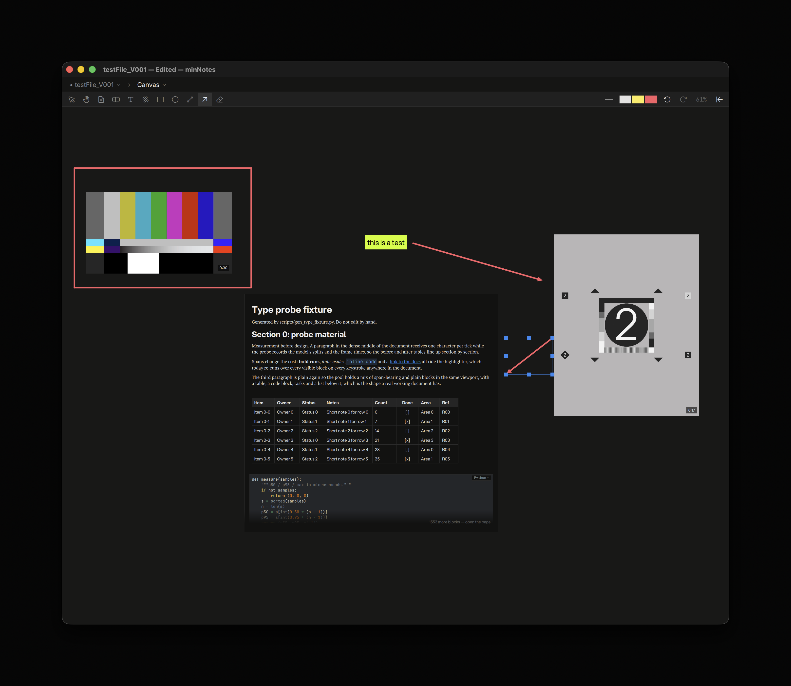
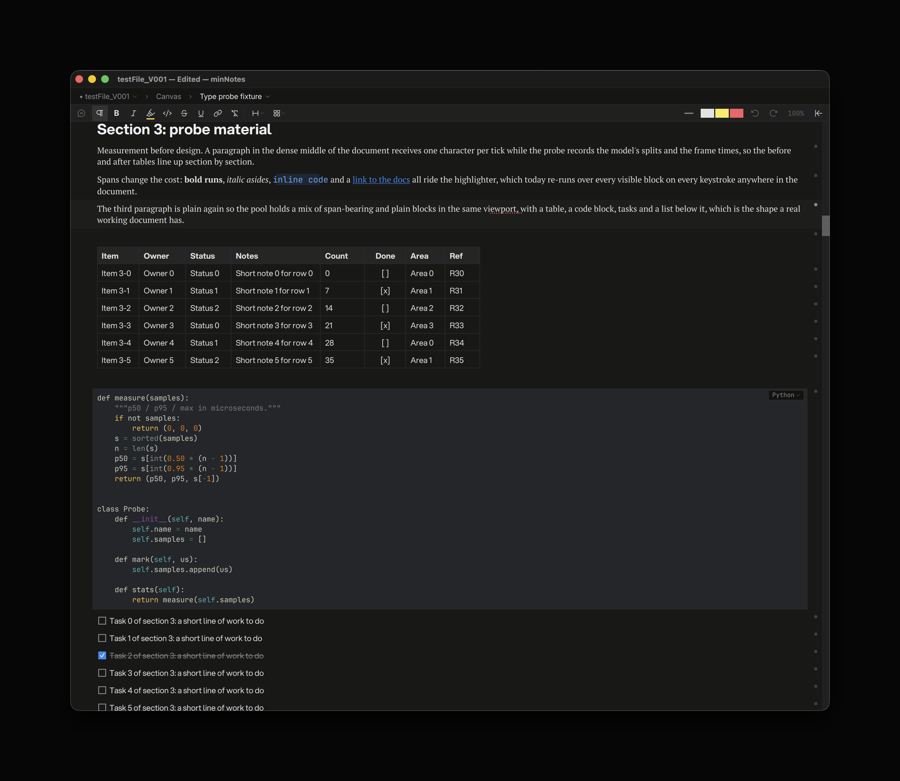
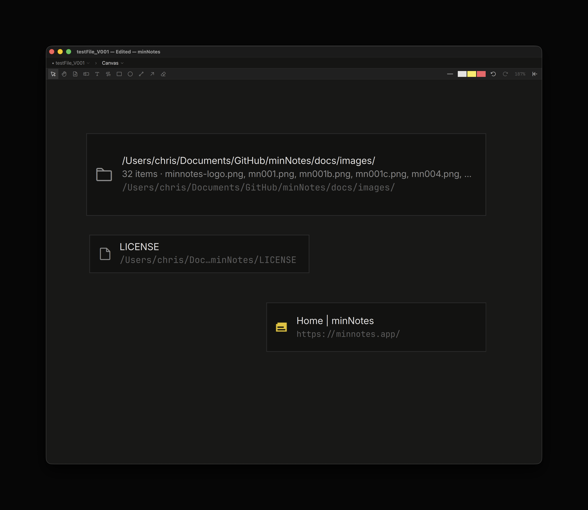
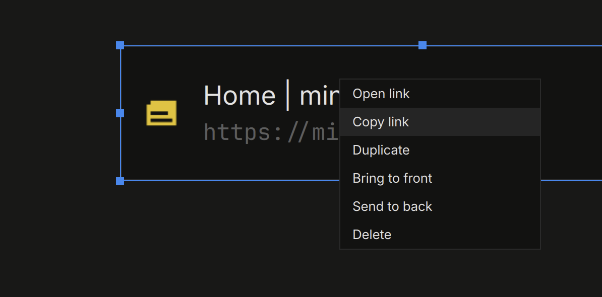
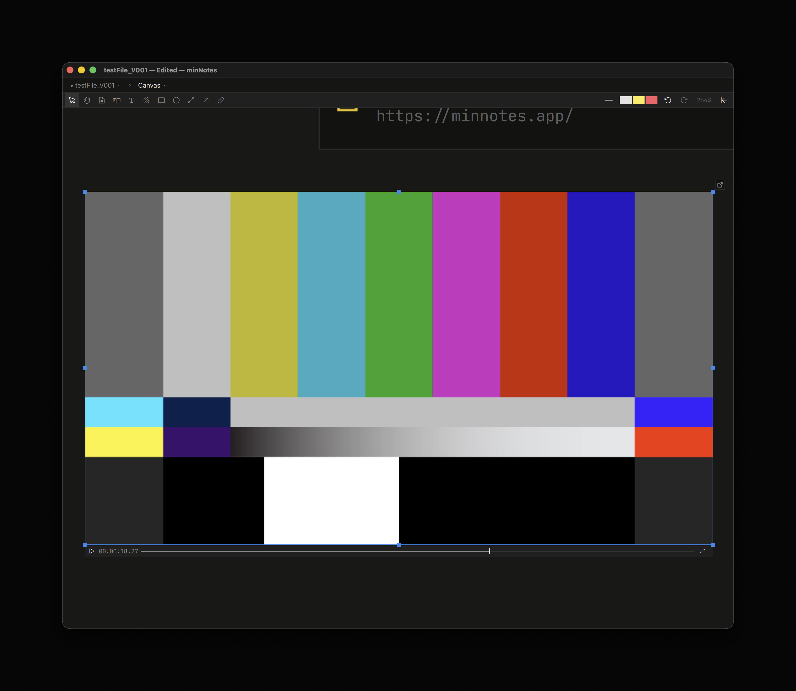
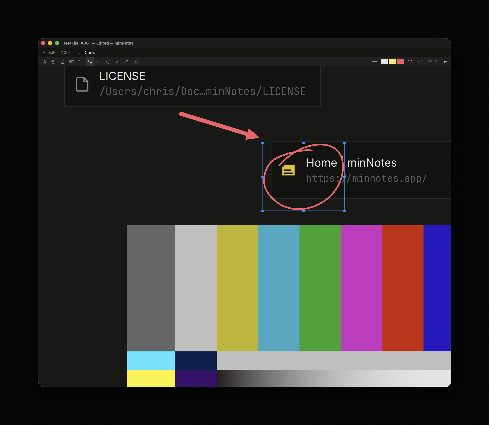

# The Canvas

Every file is a canvas. Pages are cards on it, and so is everything you
drop: video, PDFs, images, audio, folders, files, links. Pan by dragging
with the middle button, by holding `Space`, or with the **hand** tool;
zoom with `⌘+` / `⌘−`, `⌘`-wheel, or a pinch; `⌘1` fits everything in the
window and `⌘0` returns to 100%. The zoom badge at the right end of the
toolbar shows the level and opens a slider.

 

## Pages

**Double-click** a page to open it **full-window** — the page view, where
most writing happens. `Esc` there returns to the canvas with the page
selected. The open glyph at the card's top-right, **Open page** on its menu
and the path bar do the same.

To edit a page **in place**, select it and **click it again** (or press
`Return`, or click the pencil glyph above the open glyph). The card becomes a
live editor at whatever zoom you are at (the canvas zooms to at least 100%
first). Type, paste, use every block feature; the wheel scrolls inside the
card; `⌥`-drag pans the canvas around it. `Esc` hands you back the canvas
with the page selected.

 

A page's **width** is its card's width — drag a side handle and the text
reflows. Its height follows its content up to a square; drag a top or
bottom handle to pin a height (the card scrolls), double-click the handle
or choose **Fit height to content** to let it grow again. A long page shows
its first stretch with a note of how many blocks are below; open the page
to read on.

The **page tool** (`N`) places a new page where you click, or drag to size
it; **New page here** on the empty-canvas menu does the same.

## Media on the canvas

Drop a file, or paste, and it lands where you drop it:

| Dropped | Becomes |
|---|---|
| Video | A poster card. Select it for the play button and scrub line; `K` plays and pauses it in place, `Space` or `Return` previews it in the lightbox with the full transport. Double-click, the open glyph or **Open in studio** opens the review studio. |
| PDF | Its first page. Select it to page with the strip under the card or `PageUp` / `PageDown`; `Space` previews it in the lightbox with a pager; double-click or open it full-window to read, zoom and draw on its pages. |
| Image | The image, at its size up to 480 wide. Drag a corner to resize. `Space` or a double-click shows it in the **lightbox** — the picture alone over the window, with ‹ › to step through the file's media, a PDF's pager, a video's transport and ×; `Space` or `Esc` closes it. Videos, PDFs and audio preview there too. |
| Photoshop, HEIC, RAW, HDR | A rendered preview card with a format pill; the original stays in place and the card's Reveal / Open / Copy path point at it. **Refresh preview** re-renders after the source changes. (Illustrator files are PDFs; EXR stays a file card.) |
| Audio | A card with its duration and a play button. |
| Folder | A card with the folder's name, count, first entries and full path. **Spread files here** lays its files out as cards. A QCView stream folder offers **Open as stream**. |
| Any other file | A card with its name and full path. |
| A URL | A bookmark card: favicon, the page's title, the link. Right-click empty canvas for **Add link…** to type one. |
| `.mnd` / `.mnpkg` | Its pages copy in as pages, arranged as they were. |
| Markdown, text, code, HTML, Word, spreadsheets | A new page holding the import. |
| Evernote `.enex`, Notion export | One page per note, in a grid. |

Several files at once land in a grid. Every card that stands for a file
shows its **full path**, and its menu offers **Reveal in Finder /
Explorer**, **Open in ufb**, and **Copy path** — see
[Media](media.md) for where files live.

 

## Selecting and arranging

Click selects; drag on empty canvas draws a marquee; `Shift`-click adds
or removes. Drag a selection to move it, the handles to resize (videos keep
their aspect), `Delete` to delete. Right-click for the menu: Open,
Duplicate, Bring to front, Send to back, Delete, and the rows that fit the
card. Every gesture is one undo step on the canvas's own history; inside a
live page, `⌘Z` works on the page.

 

**Layers.** Open the Inspector while the canvas is up and its top section
lists the stack, front-most first: pages by their title, cards by their
file name, text chips by their first line. Ink reads as one row per run of
strokes ("Ink · 12"), so a card that sits between two runs shows between
them — the list is exactly what the canvas paints. Click a row to select
its element (a run selects all of its strokes; a run with only some
strokes selected shows a dimmer fill), `Shift`-click to add, double-click
to go live, right-click for the same menu. Drag a row to reorder, or use
`⌘]` / `⌘[` to step the selection one layer forward or back and `⌥⌘]` /
`⌥⌘[` for front and back. Each move is one undo step. History sits below
the layers.

With a **video** selected the keyboard is its transport: `Space` (or
`K`, `W`, `S`) plays and pauses, `←` / `→` (or `Q` / `E`) step frames,
`J` / `L` (or `A` / `D`) hold to shuttle, `Home` / `End` jump, `R` cycles
the review speed, `V` loops, `M` mutes. The tool letters wait until the
video is deselected. The counter shows timecode; click it to flip every
player to frames.

 

## Drawing

The canvas toolbar holds the tools, each on a single key:

| Tool | Key |
|---|---|
| Select / move | `V` |
| Hand (pan) | `H` |
| Page | `N` |
| Text box | `T` |
| Text, plain (no box) | `⇧T` |
| Pen | `P` |
| Rectangle | `R` |
| Oval | `O` |
| Line | `L` |
| Arrow | `A` |
| Eraser | `E` |

The three colour clips at the right end of the toolbar are **text**,
**highlight** and **pen**; click one to open the palette for that layer.
The **pen width** button opens a slider. With strokes selected, changing
the width or the pen colour restyles them live. Strokes are canvas
elements: select, move, duplicate and reorder them like anything else.
`Esc` cancels a stroke in progress, then drops the tool, then clears the
selection.

 

Text boxes take the pen color as their fill with contrasting type; the
plain text tool writes in the text color with no box. Both start at the
body size; double-click a chip to edit it. A chip fits its text: the box
grows as you type. Drag a side handle and the width stays where you put it,
the text wraps there and the box grows down to hold it; double-click a side
handle (or choose **Fit width to text**) to let it fit its text again.

## Exporting the canvas

**Export ▸ Canvas as HTML…** writes one self-contained file: the canvas
with pan and zoom, and a tab strip — click a page, a video or a PDF and it
opens in a tab. **Canvas Poster (PNG)…** renders the zoomed-out view as an
image. See [Export](export.md).
