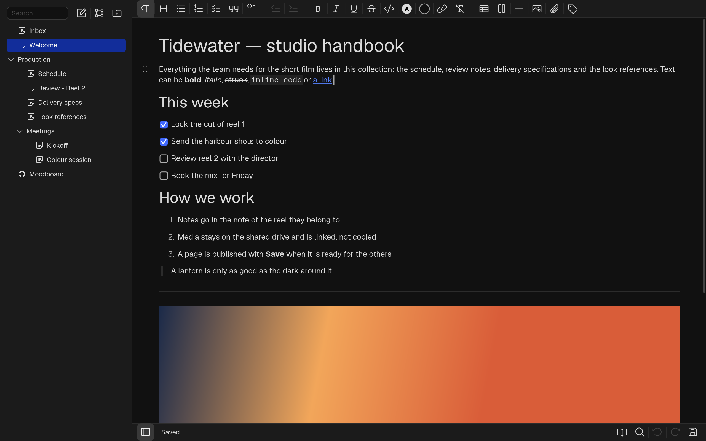
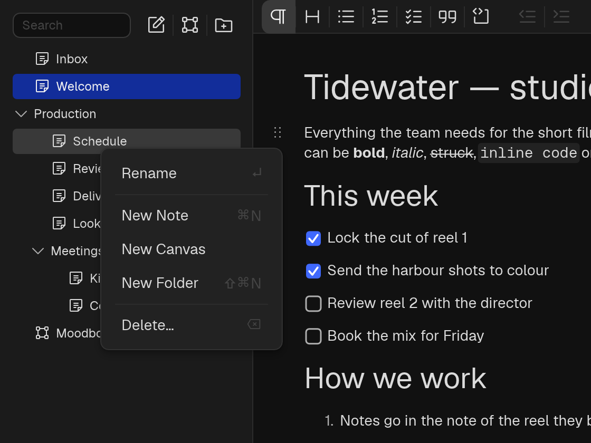
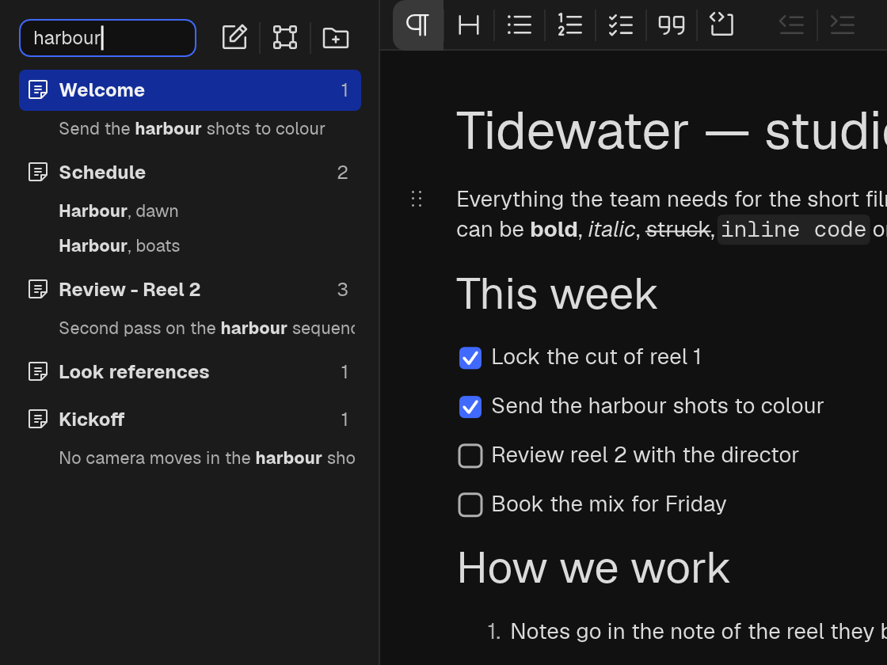
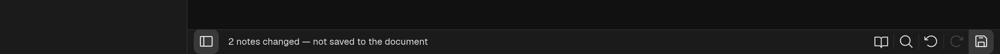

# Collections, Notes & Folders

A **collection** is one `.mnd` file. It holds **notes**, **folders** and
**canvases**, listed as a tree in the sidebar. Keep the file on a local disk,
a NAS share or a sync folder and open it from macOS or Windows.

A window shows one collection at a time. Opening another collection, or
making a new one, closes the one that is open first, and asks about changes
that are not saved to the document yet (see [Saving & Shared Storage](saving.md)).

## Starting

With no collection open the window reads "No collection is open" and offers
two buttons, **New Collection** and **Open**.

| Command | macOS | Windows |
|---|---|---|
| **File ▸ New Collection…** | `Option+Cmd+N` | `Ctrl+Alt+N` |
| **File ▸ Open…** | `Cmd+O` | `Ctrl+O` |
| **File ▸ Close Collection** | `Cmd+W` | `Ctrl+W` |

- **New Collection…** asks where to put the file and writes it there at once,
  so the file exists from the start. It opens with one empty note. If you
  choose the name of a file that is already there, that file is moved aside
  under a dated name (`name.replaced-….mnd`); it is not deleted.
- **Open…** takes a collection (`.mnd`) or a package (`.mnpkg`). A package is
  unpacked to a folder first and the unpacked collection is opened.
- **File ▸ Open Recent** lists the last ten collections you opened, with
  **Clear Menu** at the end.

## The sidebar

The sidebar lists the collection's tree. Each row is a note, a canvas or a
folder; a canvas has a box icon, a folder a caret when it has something in it.

- Click a note or a canvas to open it. Clicking a folder selects it and
  opens nothing.
- Click a folder's caret to fold or unfold it. The caret does nothing else:
  the selection stays where it was.
- The open note or canvas is the filled row.
- A dot at the end of a row marks a note with changes that are not saved to
  the document yet.
- Drag the sidebar's edge to change its width.

The three buttons at the top of the sidebar make new entries:

| Button | Menu | macOS | Windows |
|---|---|---|---|
| New note | **File ▸ New Note** | `Cmd+N` | `Ctrl+N` |
| New canvas | | | |
| New folder | **File ▸ New Folder** | `Shift+Cmd+N` | `Ctrl+Shift+N` |

A new entry goes beside the selected row, or inside it when the selected row
is a folder. A new note opens ready to type: making a note or a canvas puts
the window in editing (see [Reading and Editing](#reading-and-editing)). A new folder is called
"New folder" and opens its name for editing. A new canvas opens at once; see
[The Canvas](canvas.md).

### Names

A note has a name of its own, edited in the sidebar. Until you give it one,
a note is called by its first line, and a note with no text shows as
"Untitled". A canvas without a name also shows as "Untitled".

To rename a row, double-click it, or select it and press `Enter`, or choose
**Rename** from its context menu or **File ▸ Rename**. Type the name and
press `Enter`; `Esc` leaves the name as it was. Clearing a note's name gives
it back its first line.

### The context menu

Right-click a row for **Rename**, **New Note**, **New Folder** and
**Delete…**. Right-click the empty part of the tree for **New Note** and
**New Folder**.

### Deleting

**Delete…** asks first. Deleting a folder removes the folder and everything
in it. The entry leaves the document at the next **Save**.

If you delete the note that is open, another note opens in its place; when
none is left, a new empty note is made.

### Keys in the tree

Click a row and the tree takes the keys:

| Key | Does |
|---|---|
| `Up` / `Down` | Move the selection; a note opens as it is reached |
| `Left` | Fold a folder, or go to the row's folder |
| `Right` | Unfold a folder |
| `Enter` | Rename the selected row |
| `Delete` or `Backspace` | Delete the selected row (asks first) |
| `Esc` | Give the keys back to the note |

### What dragging does

Rows in the tree are not reordered or moved into folders by dragging. A new
entry is put where the selection is, so select a folder before you make a
note that belongs in it.

Two drags do end on the tree or start from it:

- Drag blocks by their grip onto another note's row to move them to the end
  of that note (see [Editing](editing.md)).
- With a canvas open, drag a note's row onto the canvas to put the note
  there as a card (see [The Canvas](canvas.md)).

### The User Guide

This manual is inside the application, as a folder of pages named
**User Guide** at the foot of the sidebar, after the collection's own tree.
It is put away until you ask for it.

| Command | macOS | Windows |
|---|---|---|
| **Help ▸ User Guide** | | |
| **Help ▸ Keyboard Shortcuts** | `Cmd+/` | `Ctrl+/` |
| **View ▸ Show / Hide the User Guide** | | |

- **Help ▸ User Guide** shows the folder and opens its first page.
  **Help ▸ Keyboard Shortcuts** opens the page of keys.
- **View ▸ Show / Hide the User Guide** puts the folder away, or brings it
  back. Whether it is shown is remembered on this machine.
- Click a page's row to open it. A link from one page to another opens that
  page.
- The pages can only be read: nothing can be typed in them, and their rows
  cannot be renamed, deleted, added to or dropped on.
- The guide is not part of your collection. It is not saved into the
  document, exported or packaged with it, and the sidebar's search does not
  look in it.
- The guide is shown beside a collection: with no collection open,
  minNotes asks you to open or make one first.

## Searching the collection

The field at the top of the sidebar searches every note of the collection.
Click it or press `Shift+Cmd+F` / `Ctrl+Shift+F`.

- While something is typed in the field, the results stand in the tree's
  place: one row for each note with its name and the number of occurrences,
  and under it up to three lines of the note with the word found shown
  stronger.
- A note is a result when it holds every word you typed, in any order. Put
  words in quotes to keep them together.
- Notes whose name holds the words come first; the rest follow in the tree's
  order.
- Searched: the notes' names, their text, and the notes written on videos
  that have been shown. Not searched: the text inside PDFs, and canvases.
- The search reads the collection as it stands, including changes that are
  not saved to the document yet.
- Click a result to open the note with the find bar on that word, at that
  occurrence. `Enter` opens the first result. `Esc` empties the field and
  brings the tree back.

To find text inside the open note only, use `Cmd+F` / `Ctrl+F`; see
[Editing](editing.md).

## The toolbar and the footer

The **toolbar** over the page holds what edits at the caret: block types,
indent, inline formatting and colours, and the things you insert. Its
buttons are described in [Editing](editing.md). The toolbar changes with what
is current: a video block, a picture or PDF block, and a canvas each show
their own set of tools.

The **footer** under the page holds what acts on the note and the collection
as wholes.

- At the left end, the sidebar's button; it is lit while the sidebar is open.
- Next to it, the **readout**: where the collection stands. It reads "Saved",
  "1 note changed — not saved to the document", "Saving…", and so on (the
  full list is in [Saving & Shared Storage](saving.md)). Short notices also
  appear here for a few seconds, such as "Moved 2 blocks to “Kickoff” — Undo
  takes them back".
- At the right end: reading (the book), find in this note, undo, redo and
  Save. The book is lit while the window is in reading; see
  [Reading and Editing](#reading-and-editing). The Save button is lit while
  something is not saved to the document yet.

### Hiding them

| Command | macOS | Windows |
|---|---|---|
| **View ▸ Sidebar** | `Cmd+1` | `Ctrl+1` |
| **View ▸ Toolbar** | `Cmd+2` | |
| **View ▸ Footer** | `Cmd+3` | |

**View ▸ Toolbar Over the Page / Across the Window** switches the toolbar
between sitting over the page only, beside the sidebar (the default), and
running across the whole window above the sidebar.

## Reading and Editing

The window is either in **reading** or in **editing**. Reading is for looking
at a collection without changing it by accident; editing is for writing.

- A collection that exists opens in reading. A collection you have just
  made is in editing.
- Making a note or a canvas puts the window in editing.
- The choice is remembered for each collection on this machine: a
  collection you left in editing opens in editing the next time.

One switch serves the whole window:

| Switch | macOS | Windows |
|---|---|---|
| The book button in the footer | | |
| **View ▸ Reading Mode** | `Cmd+R` | `Ctrl+R` |

The footer confirms with "Reading — the note cannot be changed" or
"Editing".

In reading:

- There is no caret and nothing can be typed. The toolbar is put away.
- Blocks show no grip, tables no handles, and a picture no outline or
  resize corners.
- You can still select and copy text, find in the note, search the
  collection, export, play and scrub a video, turn a PDF's pages and use a
  code block's copy button.
- A plain click opens a link.
- A click on a task's box still takes it to its next state (see
  [Editing](editing.md)). This is the one change reading allows.
- Writing notes on a video and drawing, on a video, a picture or a PDF
  page, are off.
- A canvas only pans and zooms: nothing on it is selected, moved, drawn or
  entered.
- A key that would change the note does nothing. The footer says
  "Reading — press Cmd+R to edit" ("press Ctrl+R" on Windows). A file
  dropped on the page gets the same answer.
- The note's text is not offered to the desktop's writing tools, such as
  Grammarly, so nothing is underlined on a page you are only reading.
- A note that is only read is never marked as changed: the frame a video
  was left on and the page a PDF shows are not written into the note while
  reading.

The sidebar is not part of reading: you can make, rename and delete
entries there in either state.

## Files dropped on the sidebar

Dropping files on the sidebar brings them into the collection. (A file
dropped on the page of a note becomes a picture or a file chip in that note
instead; see [Media & Files](media.md).)

| What you drop | What happens |
|---|---|
| A collection (`.mnd`) or a package (`.mnpkg`) | It is opened, with the usual question about unsaved changes. Other files in the same drop are left |
| Documents that **File ▸ Import…** reads (Markdown, HTML, Word and so on) | Each becomes a new note, as an import does; see [Import](import.md) |
| Any other files (pictures, videos, PDFs, anything else) | One new note, named for the first file, with the files in it as blocks |

Where the new notes go depends on the row you drop on: into a folder, beside
a note or canvas, or at the top level when you drop on the empty part of the
tree. The row is outlined while the files are over it. The footer says what
was made, and the last note made is opened.
