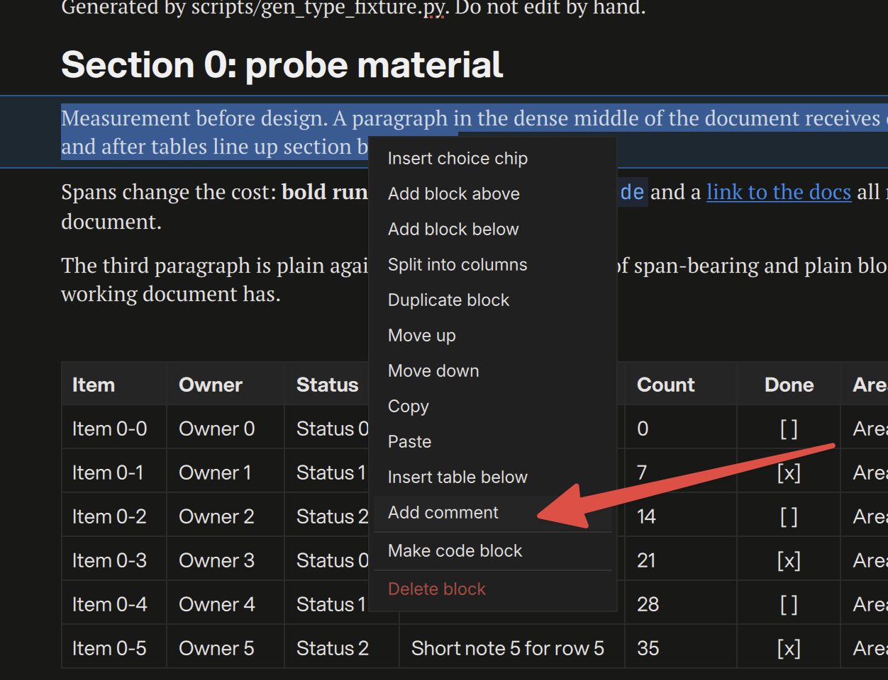
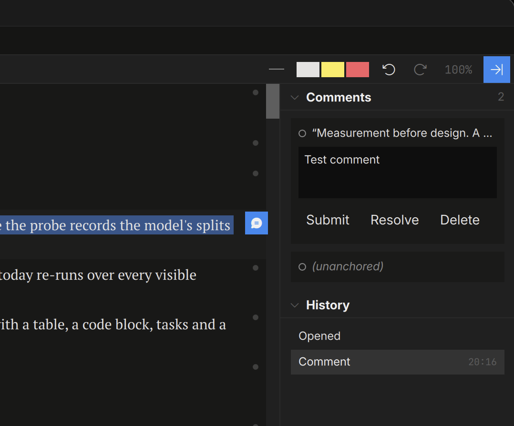

# Comments

Select text in a block and choose **Add comment** from the right-click
menu, or the speech-bubble button at the left of the toolbar. The text
gets a subtle tint and a blue bubble appears in the margin — blue means a
conversation lives here.

## Threads

Click the bubble to open the thread right there in the margin: read,
reply, **Resolve**. In the composer, `Enter` submits and `Shift+Enter`
starts a new line.

When every thread on a block is resolved, its bubble and tint go quiet
grey — settled conversations stop asking for attention. Reopen a thread
and it comes back blue.

## The Comments section

The **Inspector** (the toggle at the right end of the toolbar) has two
sections, **Comments** and **History**; each collapses with a click on its
header. Comments lists every thread in the page with its full history —
jump to any thread's block, reply, resolve, or delete from there. Adding a
comment opens the Inspector with the section expanded. On the canvas the
section lists threads whose text has gone.

## Comments in Exports

- **HTML** — threads pop up when you hover the commented text (resolved
  ones dim), and a printable list sits at the end of the page. A page
  opened from a canvas export carries its comments too.
- **Word** — comments arrive as **native review comments**, anchored to
  the text, ready for replies in Word's own UI.
- **Markdown / PDF** — comments become footnotes with timestamps and
  resolve state.
