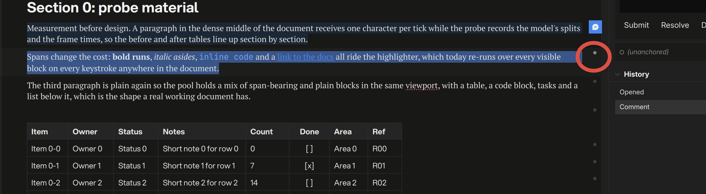
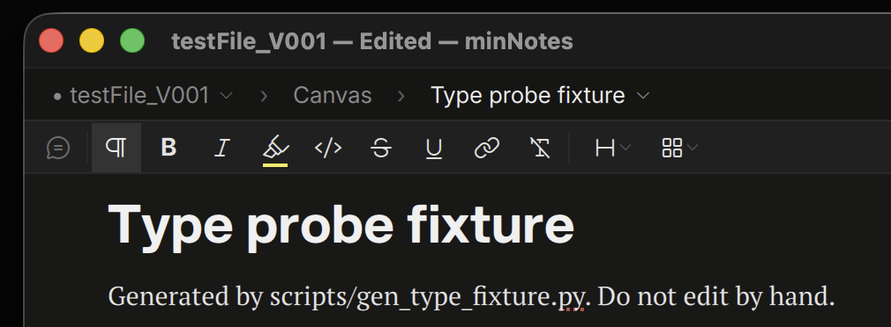
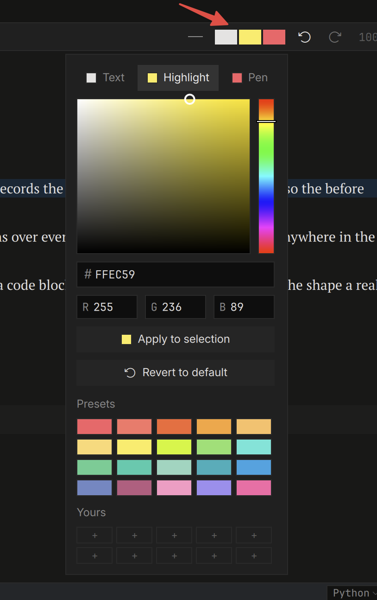
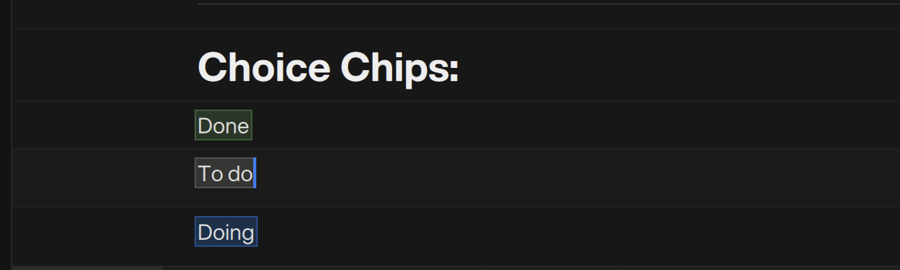
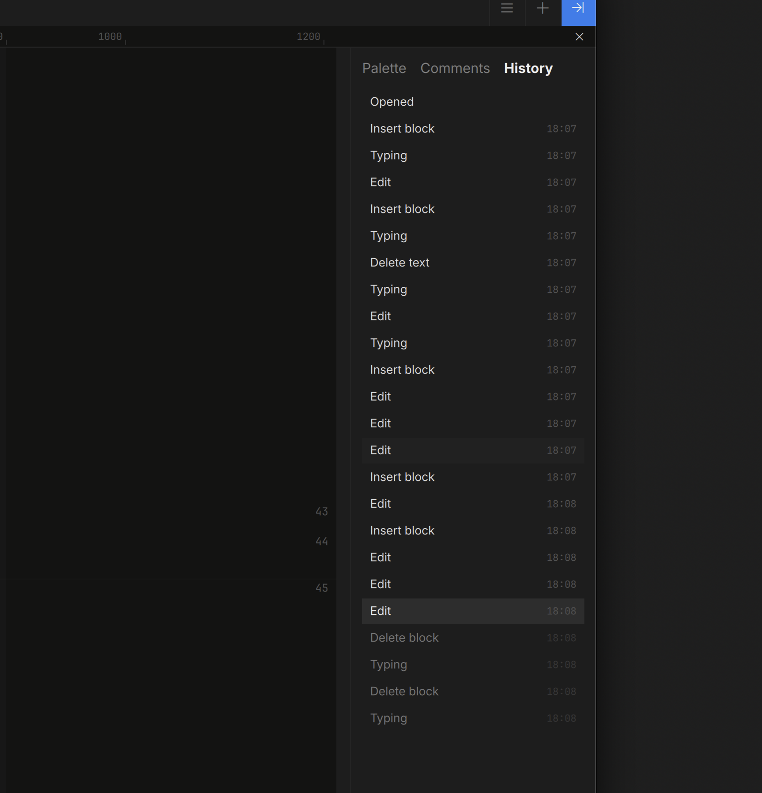

# Editing

A page is a list of **blocks**. Press `Enter` to start a new block,
`Backspace` at the start of an empty block to merge it up. Down the right
side runs the **block rail**: a handle for every block. Click a handle to
select its block, drag it to move the block (a table row's handle carries
the row; the header row's carries the table); an accent line shows where
it will land.



## The Toolbar

The toolbar changes with where you are. In a page it holds the inline
actions — paragraph, bold, italic, highlight, code, strikethrough,
underline, link, clear formatting — and two flyouts: **Heading** (the icon
shows the caret's level) and **Insert block** (quote, bullet, numbered and
task lists, a choice chip, a code block, a table, a divider).



Its right end is the same everywhere: the three colour clips, the pen
width, undo and redo, the zoom badge, and the Inspector toggle.

## Markdown-Style Triggers

Type these at the **start** of a block and it converts as you go:

| Type this | Becomes |
|---|---|
| `# ` … `###### ` | Heading 1–6 |
| `> ` | Quote |
| `- `, `* `, `+ ` | Bullet list item |
| `- [ ] ` / `- [/] ` / `- [x] ` | Task (to-do / doing / done) |
| `1. ` (any number) | Numbered list item |
| ```` ``` ```` or ```` ```lang ```` then `Enter` | Code block (optionally for a language) |
| `---` / `***` / `___` then `Enter` | Divider |

List items nest with `Tab` / `Shift+Tab`.

Every code block carries two small chips in its top-right corner: **Copy**,
which puts the block's text on the clipboard, and the **language chip** —
click it to pick the syntax highlighting from the full language list (type to
filter). The ```` ```lang ```` fence tag still works if you prefer typing it.
Long lines wrap at the page like any other text, so a command is never cut
off; exported HTML pages wrap the same way and carry the same Copy button.

## The Page

A page is as wide as its window and reflows as the window changes. Headings
are set light, body copy a little heavier, all in one sans. For a reading
measure instead, turn off **View ▸ Full
Width** (`⌘1` toggles it) and the text caps at the measure you pick there
— 640, 760 or 880 — centred in the window. These are view settings; they
change nothing in the file.

A table wider than the page runs past its right edge and the page scrolls
sideways; text never squeezes.

**Zoom** the view with `⌘+` / `⌘−`, `⌘0` for 100%, `⌘`-wheel or a
trackpad pinch to zoom about the pointer, or the zoom badge's slider. The
keys always act on what you are looking at: the page, a PDF, or the
canvas. Zoom is a view setting for the page and is not saved with it. To
**pan** a zoomed page, drag with the middle mouse button.

## Side by Side

A **split row** sets blocks side by side in **lanes**. Each lane is a short
stack of ordinary blocks — paragraphs, lists, images — and the row is as
tall as its tallest lane.

- **Make one:** right-click a block and choose **Split into columns**, or
  `⌘`-drag from the left or right edge of a block (a plain drag at a
  table cell's edge resizes the column). Dropping a dragged block or a
  file on a block's side edge puts it in a new lane beside that block.
- **Resize:** drag the gap between two lanes. It snaps at ¼, ⅓, ½, ⅔ and
  ¾; dividers that line up with the rows above and below move together —
  hold `⌥` to move just this row's.
- **Move around:** `←` / `→` walk the lanes in reading order, `↑` / `↓`
  stay in a lane until its top or bottom; `Tab` / `⇧Tab` jump to the next
  or previous lane.
- **Tidy up:** the block menu offers **Align lanes**, **Merge with the row
  below**, and **Delete lane**. Empty a lane and its space goes back to
  its neighbour; a row left with one lane becomes plain blocks again.

Tables always span the page, so a table never lands inside a lane — paste
one (or a whole split row) with the caret in a lane and it goes in just
below the row.

## Inline Formatting

Select text and use a shortcut or the toolbar — **bold**, *italic*,
`code`, underline, strikethrough, links (`⌘K`). Clear formatting on a
selection with `⌘\`.

### Colours

The three clips at the right end of the toolbar are the **text**,
**highlight** and **pen** colors. Click one to open the palette for that
layer: pick a swatch with text selected to color it; with nothing
selected the color arms for what you type next. **Apply** colors the
current selection with the armed color, **Revert** clears back to the
default, and the bottom row holds your own saved swatches. The same
palette colors table selections — whole rows and columns included (see
[Tables](tables.md)).



### Choice Chips

`⌥⌘C` inserts an inline **choice chip** — To do / Doing / Done — anywhere
in text, including inside table cells. Click the chip to change its state;
the chip travels with the text through exports.



## Undo & History

Every gesture is one undo step — a bulk table edit, a whole merge, a run
of image-resize nudges all take a single `⌘Z`. Each page has its own
history and so does the canvas; `⌘Z` works on whichever you are in. The
Inspector's **History** section shows the timeline: click any entry to
time-travel to that state (and forward again).


