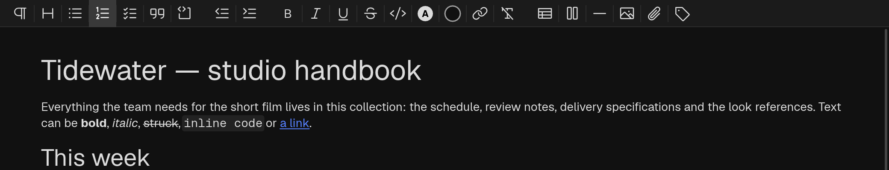
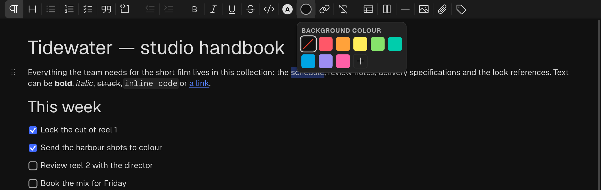
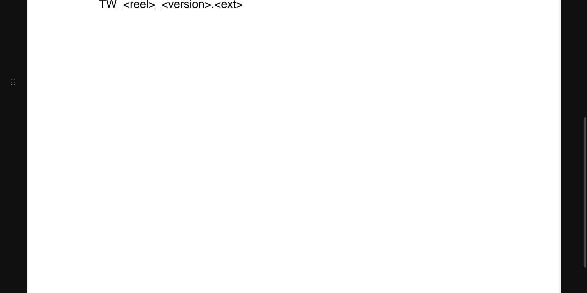
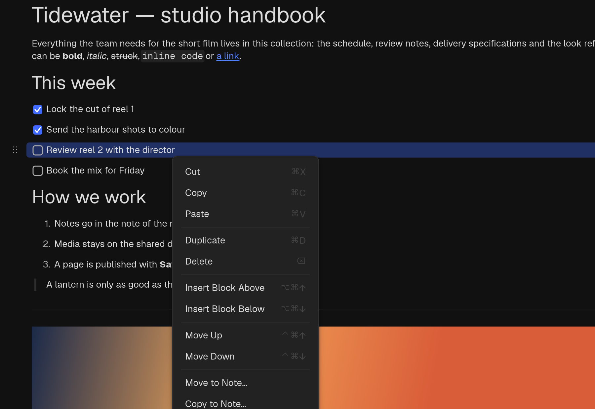
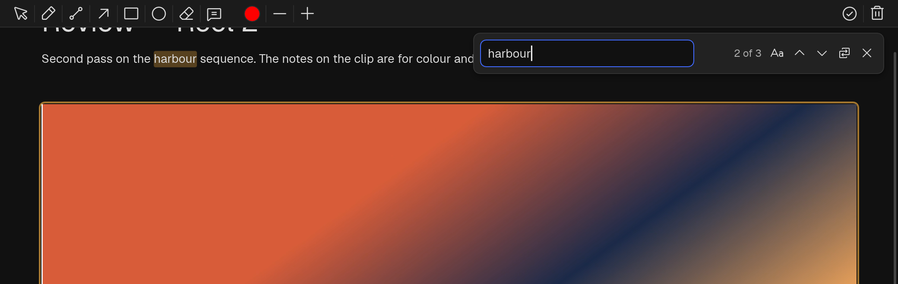

# Editing

A note is made of **blocks**: paragraphs, headings, list items, quotes, code
blocks, dividers, tables, columns, pictures and other media. You type as in
any text editor; the blocks are what you select, move and copy as wholes.

To type, the window must be in **editing**. A collection you open starts in
reading, where nothing can be typed and the toolbar is put away: press
`Cmd+R` / `Ctrl+R`, or the book button in the footer, to edit. See
[Reading and Editing](collections.md#reading-and-editing).

Formatting has two ways in, and they give the same result: the toolbar and
its keys, or Markdown typed as you go.

## The toolbar



The toolbar over the page holds what edits at the caret. A button is lit
when what it stands for is on at the caret. From left to right:

| Group | Buttons |
|---|---|
| Block type | Paragraph · Heading · Bulleted list · Numbered list · Task list · Quote · Code block |
| Lists | Outdent (`Shift+Tab`) · Indent (`Tab`) |
| Text | Bold · Italic · Underline · Strikethrough · Inline code · Type colour · Background colour · Link · Clear formatting |
| Insert | Table · Columns · Divider · Picture · File · Choice |

- A block-type button turns the caret's block (or every block in the
  selection) into that type. Pressing the same button again turns it back
  into a paragraph.
- **Heading** steps through the levels: press it once for a level 1 heading,
  again for level 2, again for level 3, and once more for a paragraph.
- When the window is too narrow for one row, the groups wrap onto further
  rows.

While a video block, a picture or PDF block, or a canvas is current, the
toolbar shows that thing's drawing tools instead; see [Media & Files](media.md)
and [The Canvas](canvas.md). Undo, redo, find and Save are in the footer.

## Markdown as you type

Type the characters as text; the one that completes a pattern converts it at
once. One undo after a conversion gives the typed characters back, for when
you wanted them as typed.

At the start of a paragraph, on the space:

| Type | Get |
|---|---|
| `#` to `######` then space | A heading, level 1 to 6 |
| `>` then space | A quote |
| `-`, `*` or `+` then space | A bulleted list item |
| `1.` (any number) then space | A numbered list item |
| `[]` or `[ ]` then space | A task, to do |
| `[/]` then space | A task, doing |
| `[x]` then space | A task, done |

The task markers also work after a `- ` has made a bullet (`- [ ] `,
`- [/] `, `- [x] `).

On `Enter`:

| Type | Get |
|---|---|
| ```` ``` ```` or ```` ```python ```` then `Enter` | A code block (with that language) |
| `---`, `***` or `___` then `Enter` | A divider, with a paragraph below it |

Inside a line, on the closing marker:

| Type | Get |
|---|---|
| `**bold**` or `__bold__` | **bold** |
| `*italic*` or `_italic_` | *italic* |
| `` `code` `` | `inline code` |
| `~~strike~~` | ~~strikethrough~~ |
| `[label](address)` | A link |

Not converted: an asterisk standing alone or between spaces (`2 * 3`), an
underscore inside a word (`snake_case`), anything inside inline code or a
code block, and anything pasted. To paste Markdown source and have it read
as Markdown, use **Edit > Paste as Markdown**.

## Lists and tasks

- `Enter` continues a list. `Enter` in an empty item steps out one level,
  and at the first level leaves the list.
- `Tab` and `Shift+Tab` nest and un-nest the items in the selection, up to
  eight levels deep.
- `Backspace` at the very start of a heading, a list item or a quote turns
  it back into a paragraph.
- The items directly below an item and deeper than it are its children: they
  travel with it when you move, copy or delete the item as a block.
- A **task** has three states: to do, doing and done. Click a task's box to
  take it to the next state: to do, doing, done, and round again. The click
  is one undo step and leaves the caret where it was; it also works in
  reading. The typed markers above set the state as you make the task.

## Inline formatting

| Format | Menu | macOS | Windows |
|---|---|---|---|
| Bold | **Format > Bold** | `Cmd+B` | `Ctrl+B` |
| Italic | **Format > Italic** | `Cmd+I` | `Ctrl+I` |
| Underline | **Format > Underline** | `Cmd+U` | `Ctrl+U` |
| Strikethrough | **Format > Strikethrough** | `Shift+Cmd+X` | `Ctrl+Shift+X` |
| Inline code | **Format > Inline Code** | `Cmd+E` | `Ctrl+E` |
| Highlight (the last background colour) | **Format > Highlight** | `Shift+Cmd+H` | `Ctrl+Shift+H` |
| Clear formatting | **Format > Clear Formatting** | `Cmd+\` | `Ctrl+\` |

With a selection, a format goes on over all of it, unless it already covers
all of it; then it comes off. With only a caret, the format is armed for
what you type next; moving the caret disarms it.

## Colours

Two colour chips sit in the toolbar's text group: **Type colour** (the
text's colour) and **Background colour** (a highlight behind the text). Each
chip shows its colour at the caret, and a press opens the same palette.



- **Default** takes that colour away.
- Eight named colours: red, orange, yellow, green, teal, blue, purple, pink.
- The collection's own colours. The **+** opens a picker (a colour square, a
  hue bar and a hex field) with **Add to Palette**; the colour is added to
  the collection, so everyone who opens it has it. Right-click one of the
  collection's colours to remove it from the palette; notes that use it keep
  it.

A background is drawn as a tint and never changes the colour of the text on
it. `Shift+Cmd+H` / `Ctrl+Shift+H` applies the background colour you used
last.

## Links

Press `Cmd+K` / `Ctrl+K`, or the toolbar's Link button, to open the link
editor at the caret. It works on the selection, on the link the caret is in,
or makes a new link.

- The editor has two fields, the address and the text, and three buttons:
  **Remove**, **Open** and **Done**. `Enter` keeps the link, `Esc` gives it
  up, `Tab` goes between the two fields.
- An address without a scheme gets `https://`; an e-mail address becomes a
  `mailto:` link.
- Paste an address over a selection to link the selection. An address you
  type (`https://…`, `www.…`) becomes a link at the space or `Enter` after it.
- `Cmd`-click / `Ctrl`-click a link to open it. A plain click places the
  caret. In reading, a plain click opens the link.
- Right-click a link for **Open Link**, **Copy Link**, **Edit Link…** and
  **Remove Link**.
- Links work in headings too; there are none in code blocks.

## Chips

A **choice chip** is a small label in running text with a set of options,
for a status inside a sentence or a list item.

- Insert one with the toolbar's Choice button or `Option+Cmd+C` /
  `Ctrl+Alt+C`. It takes the options of the chip before it in the note, or
  To do / Doing / Done when there is none, and its picker opens.
- Click a chip to open its picker. From the keys, press `Option+Down` /
  `Alt+Down` with the caret just after the chip.
- In the picker, type to filter the options; `Enter` on a name that does not
  exist adds it as a new option. **Remove chip** takes the chip out.
  **Edit options…** renames, recolours, reorders, removes and adds options;
  with **All chips with these options** ticked, the edited set goes to every
  chip of the note that shares it.
- A chip is one thing to the arrow keys and to `Backspace`.

A **file chip** is a block that points at a file: an icon, the name, the size.
The toolbar's File button adds files as chips; a second click on a chip
opens its file. See [Media & Files](media.md).

## Code blocks

Make a code block with the toolbar's Code block button, or type ```` ``` ````
(or ```` ```python ````) and press `Enter`. In a code block `Enter` is a new
line of code, formatting keys do nothing, and Markdown is not converted.



The block's top right corner holds two controls:

- **The language.** A block without one reads "Plain text". Click the label
  for a list of languages with a field that filters it ("Find a language…");
  click a language or press `Enter` to pick it. A language typed there that
  minNotes does not know is kept as typed.
- **The copy button** copies the whole block as plain text. The footer says
  "Copied".

Code is coloured by language: comments, strings, numbers, keywords, types
and function names. A block with no language or an unknown one stays in one
colour, as does a block of 5,000 lines or more. The colouring is a simple
reader, not a full grammar: a language inside another (script inside HTML),
regular-expression literals and string interpolation are not understood.

## Columns

Columns set blocks side by side.

- The toolbar's **Columns** button puts a column beside the caret's block:
  the block becomes the first of two columns and the caret goes into the
  second. Press it again inside a column for one more.
- Or drag blocks by their grip to the left or right end of a top-level
  block; an upright line shows where the new column will be.
- There are six columns at most. Columns do not go inside a column or inside
  a table's cell.
- Drag the gap between two columns to trade width between them.
- On a narrow page, when a column would become too narrow, the columns stack
  one under the other.
- A column that is emptied goes away: drag its blocks out, or press
  `Backspace` in its one empty paragraph. When one column is left, it turns
  back into ordinary blocks.
- `Up` at the top of a column and `Down` at its foot leave the columns for
  what is above or below them. Where nothing is there, a paragraph is made.

## Selecting whole blocks

Press `Esc` to select the caret's whole block (or, with a text selection,
the blocks it touches). Then:

| Key | Does |
|---|---|
| `Up` / `Down` | Step to the block above / below |
| `Shift+Up` / `Shift+Down` | Grow the selection |
| `Cmd+A` / `Ctrl+A` | Select every top-level block of the note |
| `Enter` or `Esc` | Go back to the caret |
| `Backspace` or `Delete` | Remove the selected blocks |
| `Cmd+C` / `Cmd+X` / `Cmd+V` (`Ctrl` on Windows) | Copy, cut, paste whole blocks |
| `Cmd+D` / `Ctrl+D` | Duplicate |

Typing does nothing while blocks are selected.

## The grip and the block menu

A grip stands in the left margin beside the first line of the caret's block
(or of the first selected block). It belongs to the caret, not to the
pointer: nothing appears as you move the mouse.

- **Click the grip** to select the block.
- **Drag the grip** to move the block, with its children, or every selected
  block. A line shows where the blocks will land and a small label says how
  many; no line means they cannot go there. `Esc` cancels. The drop is one
  undo step. Blocks can be dragged into and out of columns and table cells.
- **Right-click a block** for its menu. The block under the pointer is
  selected first; blocks that are already selected stay selected when it is
  one of them.



| Menu item | macOS | Windows |
|---|---|---|
| **Cut** | `Cmd+X` | `Ctrl+X` |
| **Copy** | `Cmd+C` | `Ctrl+C` |
| **Paste** | `Cmd+V` | `Ctrl+V` |
| **Duplicate** | `Cmd+D` | `Ctrl+D` |
| **Delete** | `Backspace` | `Backspace` |
| **Insert Block Above** | `Option+Cmd+Up` | `Ctrl+Alt+Up` |
| **Insert Block Below** | `Option+Cmd+Down` | `Ctrl+Alt+Down` |
| **Move Up** | `Ctrl+Cmd+Up` | `Alt+Shift+Up` |
| **Move Down** | `Ctrl+Cmd+Down` | `Alt+Shift+Down` |
| **Move to Note…** | | |
| **Copy to Note…** | | |

- **Insert Block Above / Below** makes an empty block beside the selection
  with the caret in it. Beside a list item it is an item of the same kind.
- **Move Up / Down** moves the blocks one place. An item moves with its
  children and never lands between another item and its children.
- Media blocks have a few more items at the top of this menu (such as
  **Reveal in Finder** / **Show in Explorer** and **Copy Path**); see
  [Media & Files](media.md).

### Moving blocks to another note

- Choose **Move to Note…** or **Copy to Note…** and pick a note from the
  list. The blocks go to the end of that note.
- Or drag the grip onto another note's row in the sidebar; the row is
  outlined. Hold `Option` / `Alt` as you let go to copy instead of move.

The footer says what was done. One undo, in the note the blocks left, takes
a move back whole, as long as neither note has been edited since.

## Copy and paste

- Copying writes formatted text as well as plain text, so headings, lists,
  tables, links and inline formatting reach other applications.
- **Edit > Paste** (`Cmd+V` / `Ctrl+V`) takes, in this order: blocks or text
  copied in minNotes, with their formatting; files copied in the Finder or
  Explorer (as if dropped); formatted text from another application, as
  blocks; a picture; plain text. In a code block only the text is pasted.
- **Edit > Paste and Match Style** (`Shift+Cmd+V` / `Ctrl+Shift+V`) pastes
  the text alone.
- **Edit > Paste as Markdown** reads the clipboard's text as Markdown source.
- A web address alone on the clipboard pastes as a link.
- **Export > Copy as Markdown** (`Shift+Cmd+C`) copies as Markdown; see
  [Export](export.md).

## Find and replace in a note

`Cmd+F` / `Ctrl+F`, or the magnifier in the footer, opens the find bar at
the page's top right. With one line of text selected, the bar opens on that
text.



- Every occurrence is marked as you type, the current one more strongly; the
  bar counts them ("3 of 12").
- `Enter` or `Cmd+G` / `Ctrl+G` goes to the next, `Shift+Enter` or
  `Shift+Cmd+G` / `Ctrl+Shift+G` to the previous, round the ends.
- **Match case** is the one switch. Without it, case and accents are set
  aside.
- Found: all text, including table cells, code and chip labels; links'
  addresses; the names of pictures and files; and the notes written on a
  video (the video block is the hit). The text inside PDFs is not searched.
- The **Replace** switch opens a second row: **Replace** changes the current
  occurrence (`Enter` in that field does the same), **Replace All** changes
  all of them as one undo step. `Tab` goes between the two fields. Chips,
  choice cells and links' addresses are left alone, and the footer says how
  many were replaced.
- `Esc` closes the bar with the selection on the current occurrence.

To search every note of the collection, use the sidebar's field; see
[Collections, Notes & Folders](collections.md).

## Undo and redo

**Edit > Undo** (`Cmd+Z` / `Ctrl+Z`) and **Edit > Redo** (`Shift+Cmd+Z` /
`Ctrl+Shift+Z`), also in the footer.

- Each note has its own history, kept while the window is open. Going to
  another note and back does not lose it.
- A canvas has a history of its own, and so do the drawings on a video.
- After a save that merged someone else's changes into the open note, that
  note's history starts over.

## Writing tools

minNotes has no spelling or grammar checker of its own. Instead, on macOS,
the text of the open note is shown to the system as one text field, the way
a native text editor's is. A writing tool installed on your Mac that works
through the system's accessibility interface, such as Grammarly, can read
the note, underline what it finds, and correct it. Its corrections arrive in
the note as ordinary typing.

- The tool sees the note's text, whatever its blocks. It does not see the
  text inside a PDF.
- The text is offered only while the window is in editing. In reading the
  tool is shown nothing, so nothing is underlined.
- What such a tool sends to its maker is that tool's matter. minNotes itself
  sends nothing; see [Privacy](privacy.md).
