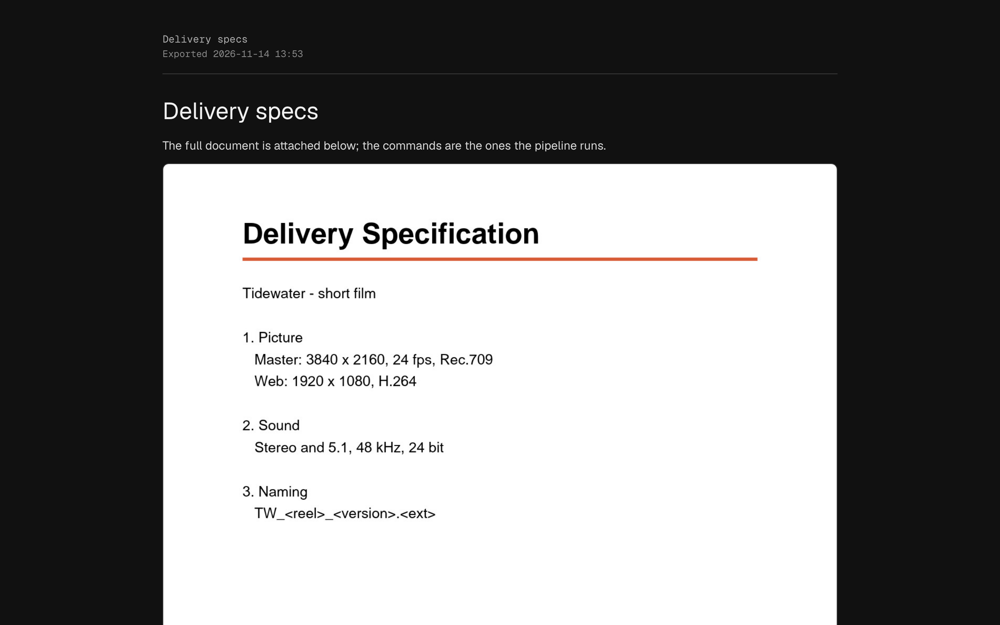
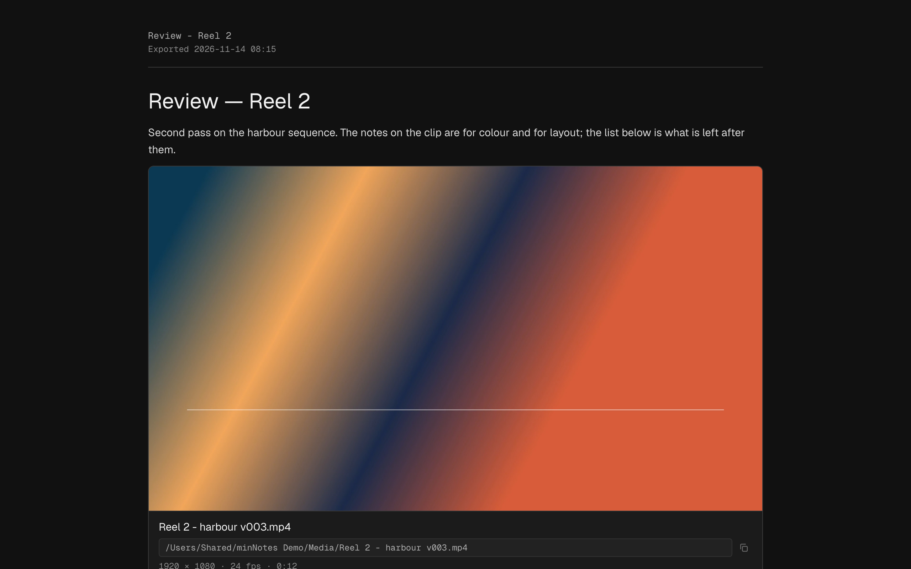
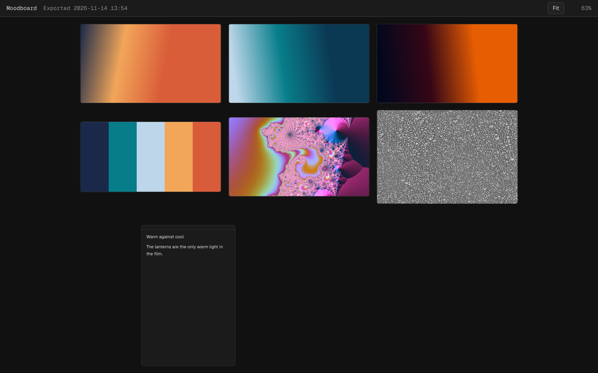

# Export

The **Export** menu writes the note or canvas you have open for other
applications and other people.

| Item | Keys | What it writes |
|---|---|---|
| **as HTML…** | | The open note, or the open canvas, as one file for a browser |
| **as Web Folder…** | | One note, chosen notes or the whole collection as a folder of pages. See [Web Folder](web-folder.md) |
| **as Markdown…** | | The open note as a `.md` file with a folder of pictures |
| **as Word Document…** | | The open note as a `.docx` file |
| **as PDF…** | | The open note as a PDF |
| **Canvas Poster (PNG)…** | | The open canvas as one picture |
| **Collection as Package…** | | The whole collection and its media as one file. See [Collect Media & Packages](packages.md) |
| **Copy as Markdown** | `Shift+Cmd+C` / `Shift+Ctrl+C` | The selected blocks, or the whole note, on the clipboard |
| **Include File Paths** | | An option with a tick. See [The Two Options](#the-two-options) |
| **Include Video Notes** | | An option with a tick |

The one-file exports write the **open note** only, headed by the note's
name. There is no export of a selection to a file; **Copy as Markdown**
is the way to take part of a note.

Each export asks where to save, with the note's name as the file's name.
There is no options dialog.

## Exports Run in the Background

What goes out is the note as it stands at the moment you choose the
command. The file is then written in the background, and you can go on
typing in the note. The footer reads "Exporting" with the file's name,
then "Exported" with the file's name.

One export is written at a time. If you start a second, the footer says
"An export is still being written — one at a time".

## as HTML…

One self-contained file that you can send to anyone with a browser. The
typeface, the pictures and the scripts are all inside it.

- Text keeps its formatting, colours and highlights. Tables, columns,
  task lists and quotes look as they do in the note. Task boxes show
  their state and cannot be clicked.
- **Code blocks** keep their colours. Each has its language's name and a
  copy button in its top right corner. Where the browser refuses the
  clipboard, the button selects the code so that you can copy it by hand.
- **Pictures** are in the file. Click one for the lightbox: the arrow
  keys step through the page's pictures, `Esc` closes it.
- **Drawings** on a picture, a PDF page or a video frame are a layer of
  their own over the clean picture. Press `A` to hide or show them.
- **A video** is not in the file. It appears as a still of the frame its
  block stands on, with the file's name. With **Include Video Notes**
  ticked, the clip's notes follow: each note's frame as a still with its
  drawings, its timecode and its words. See
  [Drawing & Video](annotations.md).
- **A PDF** appears as the page its block shows, plus every page that
  has been drawn on.
- **File paths** sit in a box with a copy button, when **Include File
  Paths** is ticked, so that a reader can find the real file.

The page is dark on screen and prints on white, without the buttons.

Videos that play in the browser need a [Web Folder](web-folder.md).

## as Markdown…

A `.md` file, and beside it a folder named after the file with
`.assets` at the end, which holds the pictures. Exporting **Welcome** as
`Welcome.md` makes `Welcome.assets/`.

Markdown is the plain form. It has no colour, no highlight and no
columns, so those are lost; a chip is written as its label. Code keeps
its text in a fenced block, without colours. Markdown has no layers
either, so drawings are drawn into the pictures.

## as Word Document…

A `.docx` file for Word and the applications that read it.

- Headings are real **Heading 1** to **Heading 6** styles, so the
  document has an outline.
- Numbered lists are real numbered lists, each with its own numbering.
  Task boxes are written as text.
- Links can be clicked. Code keeps its colours.
- Tables keep the note's column proportions, and their header rows
  repeat on each page.
- Columns are kept side by side.
- Drawings are drawn into the pictures.
- The fonts are Arial and Courier New, which both systems have.

A Word document exported from minNotes can be [imported](import.md)
again and comes back as it went out.

## as PDF…

The note as it is laid out in the editor, cut into pages between lines.

- The paper is A4 where the system uses metric measures and Letter
  elsewhere, with margins of 0.75 inch.
- Text can be selected and searched, and links can be clicked. The
  typeface is embedded.
- A table's row, and a picture with its caption, stay together when they
  fit on a page.
- A table wider than the page is drawn smaller to fit.
- A media block shows its picture, its name, its path and its facts, a
  PDF's drawn-on pages and a clip's notes.

## A Canvas

With a canvas open, two items apply. The others say in the footer that
"A canvas exports as HTML or as a poster".

**as HTML…** writes the canvas as one file that opens on the canvas
itself, fitted to the window.

| To | Do this |
|---|---|
| Move over the sheet | Drag, or turn the wheel |
| Zoom | `Cmd` + wheel / `Ctrl` + wheel, or `+` and `-` |
| Fit the canvas to the window | `0` |
| See it at its own size | `1` |
| Read a note card in full | Click it. `Esc` returns to the canvas |

Every card is where you put it. A note card holds its note, cut at the
card's height. Pictures and PDF pages open in the lightbox, with their
drawings as a layer. Strokes, shapes and frames are drawn. A video card
with notes shows their stills in a row under its picture when **Include
Video Notes** is ticked; each opens in the lightbox with its drawing and
its words.

**Canvas Poster (PNG)…** writes the whole canvas as one picture, 1600
pixels wide: notes as sheets with their title, pictures, strokes, frames
and text. With a note open instead, the footer says "Open a canvas to
make its poster".

See [The Canvas](canvas.md).

## Copy as Markdown

**Copy as Markdown** (`Shift+Cmd+C` / `Shift+Ctrl+C`) puts the selected
blocks on the clipboard as Markdown, or the whole note when no blocks are
selected. Nothing is written to disk: a picture is named where it is. The
footer confirms with "Copied the note as Markdown", or the number of
blocks.

## The Two Options

The last two rows of the menu are options. Each has a tick, both are on
at first, and they stay as you set them.

- **Include File Paths**: under a referenced file's name, the export
  shows where the file is on this machine. Turn it off when the paths
  would mean nothing to the reader, or should not be shown.
- **Include Video Notes**: a video is followed by its notes, with their
  frames, drawings and words. Turn it off to show the still alone.

They apply to every export on this page and to the web folder.

## Web Folder

**as Web Folder…** writes pages a browser opens from a shared drive or a
web server: one note, chosen notes or the whole collection, with a list
of the notes, a search, videos that play, and an optional password. It
has its own page: [Web Folder](web-folder.md).

## Packages

**Collection as Package…** is for handing the collection itself to
someone who has minNotes: one `.mnpkg` file with the collection and
every file it shows. See [Collect Media & Packages](packages.md).
