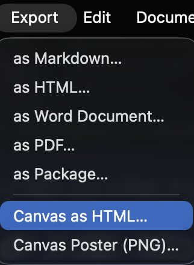
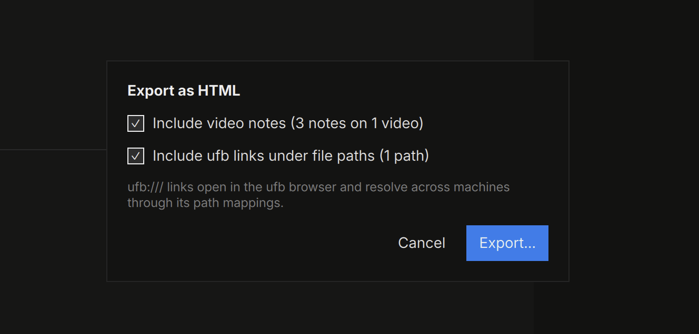
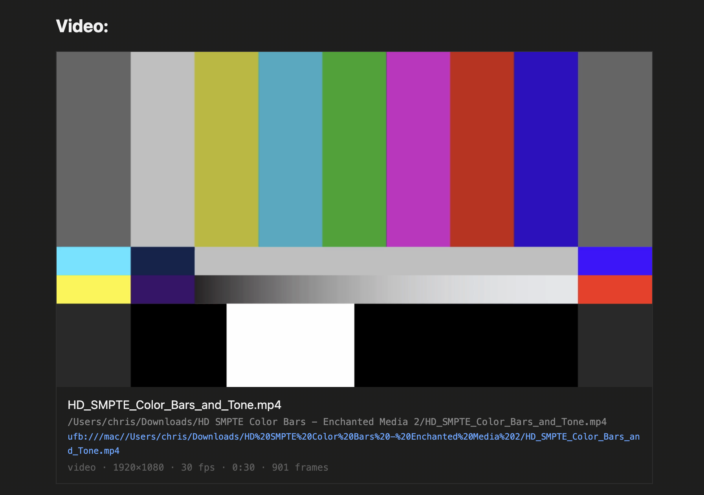

# Export

The **Export** menu writes the page you are in, in four formats, the whole
file as a [package](packages.md), and the whole canvas as HTML or a PNG
poster. Every page export leads with the page's name as a small mono
label.

## Page formats

- **Markdown** — a portable `.md` plus a `.assets/` folder holding every
  image and video-note thumbnail. Code blocks keep their language on the
  fence.
- **HTML** — one self-contained file you can send anywhere. The page is
  the width of the browser window, like the app, with a **Readable width**
  button in the header that caps the measure (the browser remembers the
  choice). Colours, highlights, syntax-coloured code with its language
  chip, and tables survive exactly; the app's own typefaces travel inside
  the file — PT Serif for paragraphs, the sans for everything else — so
  lines wrap where they wrap in the app. Task boxes are **checkable**, and
  the browser remembers what you ticked. Click any image — table cells
  and video-note frames included — for the built-in lightbox.
- **Word (`.docx`)** — code blocks keep their syntax colours and carry
  their language; paragraphs are set in PT Serif; media ink is baked into the
  images; table cells are set in 7pt with tight margins so more copy fits
  a page.
- **PDF** — print-ready pages with images fitted, tables printed at
  their column widths in smaller type on a hairline grid (a table wider
  than the page continues in column bands, the way a spreadsheet prints
  across pages, with header rows repeated), and marked-up PDF pages
  exported as baked images.

[Split rows](editing.md#side-by-side) stay side by side in HTML, Word,
and PDF, at the widths you set; Markdown has no columns, so it stacks the
lanes in reading order.

**Copy as Markdown** (`⇧⌘C`) puts the selection — or the whole page —
on the clipboard in the same Markdown dialect, no files written.

## The canvas as HTML

**Export ▸ Canvas as HTML…** writes one file holding the whole canvas.
It opens on the canvas itself: drag to pan, `⌘`-wheel to zoom, `0` to fit.
A strip across the top holds tabs — click a page card and the full page
opens in a tab, as the page export above; click a video and its tab shows
the poster, the file's name and path, and its QCView notes as a
filmstrip of marked-up frames; click a PDF for its first page and every
page that carries ink. Images open in the lightbox. Folder, file, link and
audio cards print their paths. `Esc` returns to the canvas, and the tabs
stay open while you look around.

 

**Canvas Poster (PNG)…** renders the zoomed-out canvas — pages as sheets
with their titles, media thumbnails, ink — as one image.

## Export Options

Options appear only when they apply:

- **Include video notes** — QCView-style notes render under each video,
  marked-up frames included.
- **Include ufb links** *(off by default, remembered)* — adds a clickable
  `ufb:///` deep link under every file path in the export. Anyone with
  [ufb](https://github.com/cbkow/ufb) installed clicks the link and lands
  on that file in their browser — cross-platform, resolved through ufb's
  own path mappings.

## References

Videos, PDFs, and file attachments export as a poster image plus a
reference card — name, full path, and metadata — so a reader can find the
real file:

Images always collect into the export (sandboxed viewers can't read
absolute paths); videos and other large files stay pointers by design.
