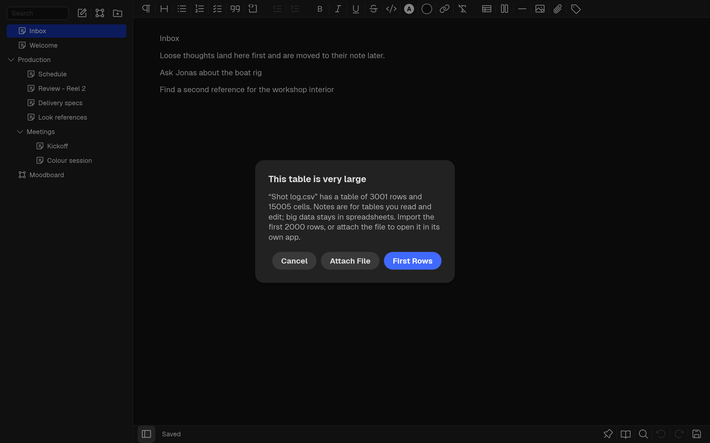

# Import

An import turns a file from another application into a **note** of the
open collection. There are two ways to import, and both need a collection
to be open:

- **File > Import…** opens the system's file panel. Choose one file or
  several.
- Drop the files on the **sidebar**.

A file dropped on the **page** is not imported: it stays what a drop on
the page always is, a picture or an attached file chip. See
[Media & Files](media.md).

## What Happens

Each file becomes one new note, named after the file without its
extension, and the note is opened. A file is never spliced into the note
you have open. Several files are read one after another.

While a file is read the footer says "Importing" with the file's name,
and you can keep working. When it is done the footer says "Imported" with
the note's name.

An import is not an undo step. To take it back, delete the note.

## Formats

A file is told by its extension alone.

| Kind | Extensions | What it becomes |
|---|---|---|
| Markdown | `.md` `.markdown` `.mdown` | Headings, quotes, nested lists, task lists, fenced code, rules, tables (with the alignment of the rule line), pictures |
| Web page | `.html` `.htm` | Paragraphs, headings, lists, quotes, code blocks, tables, links, pictures |
| Plain text | `.txt` `.text` | A paragraph per line, as written. Empty lines part the paragraphs; nothing is converted |
| Log | `.log` | One code block of no language |
| Table | `.csv` `.tsv` `.tab` | One table; the first row is the header |
| Word, OpenDocument text | `.docx` `.odt` | Headings, lists, formatting, links, pictures, tables with header rows and merged cells |
| RTF, old Word | `.rtf` `.doc` | macOS only, through the system's converter |
| Spreadsheet | `.xlsx` `.ods` | A table per sheet |
| Source code | 38 extensions, see below | One coloured code block |

**Tables from CSV.** A `.csv` may be separated by commas, semicolons or
tabs: the separator is found from the first line. A `.tsv` or `.tab` is
always read with tabs. Quoted cells may hold the separator and line
breaks. Empty rows and columns at the end are left out.

**Spreadsheets.** Every sheet with content is a table whose first row is
the header. When there are several sheets, each table stands under a
heading with the sheet's name. Excel dates are written as `YYYY-MM-DD`
and times as `HH:MM`. A formula gives its last value. Pictures in sheets
are read: one laid over an Excel sheet goes into the cell at its top left
corner, one placed in a cell goes into that cell, and a floating picture
of an OpenDocument sheet follows the table. A picture in a cell is shown
at most 240 pixels wide.

**Word documents.** Headings are read by style or outline level, lists by
the kind of their numbering. A Word document that minNotes exported comes
back as it went out, code blocks and their languages included.

**Source code.** The file becomes one code block whose language is the
extension, coloured as any code block is: `py` `js` `ts` `jsx` `tsx` `c`
`cc` `cpp` `cxx` `h` `hpp` `m` `mm` `cs` `java` `kt` `swift` `go` `rs`
`rb` `php` `sh` `bash` `zsh` `sql` `json` `yaml` `yml` `toml` `xml` `ini`
`css` `scss` `lua` `pl` `r` `cmake` `ps1`.

### What Is Kept and What Is Not

- Bold, italic, underline, strikethrough, inline code and links are kept.
- Text colour and highlight are kept, except greys.
- Not read: review comments, footnotes, the backgrounds of cells and the
  widths of columns.
- A Markdown, text, code or table file larger than 32 MB is not
  imported. The dialog suggests dropping it into a note to attach it
  instead.
- A kind of file minNotes does not import is named in the footer and
  left out.

## Pictures

A picture that a Markdown, HTML or RTF file names by a path is looked for
against the folder the file is in, and **copied** into the collection's
`minNotes Media` folder. The note does not depend on the folder the file
came from.

A picture that is not found is left out, and the footer says how many
were not found, for example "Imported Welcome — 1 picture was not found".

A picture named by a web address is fetched when it is first shown, and
is then kept with the collection as well.

Pictures inside Word, OpenDocument and Excel files are kept with the
collection in the same way.

## Very Large Tables

Notes are for tables you read and edit. A table of more than **10 000
cells** is not imported whole. minNotes asks first:

| Button | What it does |
|---|---|
| **First Rows** | Imports the first rows of the table, as many as fit in 10 000 cells. The dialog names the number. Only the oversized table is cut; what follows it in the file stays |
| **Attach File** | Makes a note named after the file that holds the file as a chip, to open in its own application |
| **Cancel** | Imports nothing |

## Where the New Notes Go

With **File > Import…**, a new note goes beside the entry selected in the
sidebar. When the selected entry is a folder, the note goes inside it.

With a drop on the sidebar, the row you drop on decides, and it is
outlined while you drag:

- on a **folder**: inside it;
- on a **note** or a **canvas**: beside it;
- below the rows: at the top level of the collection.

New notes always land after what is already there. The last note made is
opened.

In the Tidewater example, dropping `Call sheet.docx` on the
**Production** folder makes a note **Call sheet** inside it, after
**Look references**.

## Other Files Dropped on the Sidebar

Not everything dropped on the sidebar is a document to import.

- **Pictures, videos, PDFs and any other files** become **one** new note,
  named for the first file, with the files in it as blocks. Folders are
  not walked. The footer says "Made a note of" with the name or the
  number of files.
- **A collection** (`.mnd`) or **a package** (`.mnpkg`) is **opened**.
  If the open collection has changes that are not saved, minNotes asks
  about them first. A package is unpacked to a folder before it opens;
  see [Collect Media & Packages](packages.md). When other files are
  dropped with it, only the collection is taken.

Documents and other files can be dropped together: the documents are
imported, then the rest become their one note.

## Pasting

Content on the clipboard comes in through the **Edit** menu.

| Command | Keys | What it does |
|---|---|---|
| **Paste** | `Cmd+V` / `Ctrl+V` | Pastes with structure and formatting |
| **Paste and Match Style** | `Shift+Cmd+V` / `Shift+Ctrl+V` | Pastes the text alone |
| **Paste as Markdown** | none | Reads the clipboard's text as Markdown source and pastes the blocks it describes |

**Paste** takes the richest thing the clipboard offers:

- Blocks or a text selection copied in minNotes come back as they were.
- Files copied in Finder or Explorer are added as if they were dropped
  on the page.
- Formatted text from another application (a word processor, a mail
  program, a browser) becomes blocks: paragraphs, headings, lists, task
  lists, quotes, code blocks, rules and tables, with bold, italic,
  underline, strikethrough, inline code and links. The colours, fonts and
  sizes of the other application are dropped, so the text takes the look
  of your note. This is where a paste differs from an import, which keeps
  colours.
- A picture's pixels (a screenshot, a browser's Copy Image) become a
  picture kept with the collection.
- A web address on its own becomes a link. Over a selection, it links
  the selection.
- Rows and columns copied from a spreadsheet become a table, or fill
  cells from the caret's cell when the caret is in a table.

Pictures in pasted formatted text or Markdown that are named by a web
address are fetched when they are first shown, and kept with the
collection.

Inside a code block, a paste is always the text alone.

**Paste as Markdown** is for Markdown source you copied as text, such as
a snippet from a README. With **Paste** the same text would arrive as
written, markers and all.
