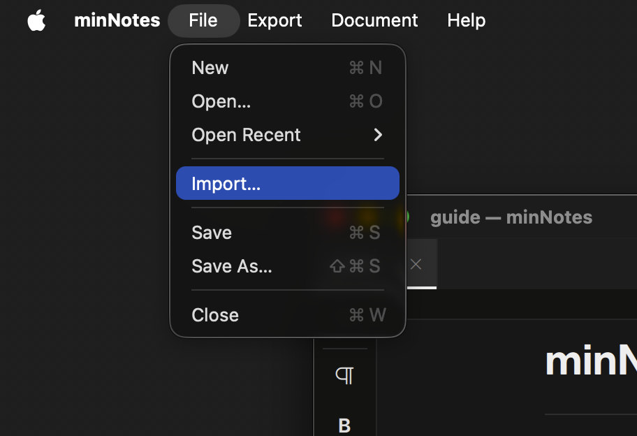

# Import

**File ▸ Import…** — or drop a file on the welcome screen, on the canvas,
or into a page — brings existing material in. From the menu or the
welcome screen a file becomes a fresh untitled file (nothing touches disk
until you save); dropped on the canvas it becomes a **new page** where
you dropped it; dropped into a page it lands in that page.

| Format | Notes |
|---|---|
| Markdown (`.md`) | GFM tables, fenced code with language, tri-state tasks |
| Plain text (`.txt`) | Markdown-style prefixes convert on the way in |
| CSV / TSV | Becomes a table; first row is the header |
| HTML | Headings, lists, formatting, tables, images |
| Word (`.docx`) | Round-trips minNotes' own exports, including comments |
| Excel (`.xlsx`) | Sheets become tables — **including images in cells** (both the floating and place-in-cell kinds) |
| OpenDocument (`.ods` / `.odt`) | Calc sheets → tables; Writer docs with styles, lists, images |
| Source code | 37 languages → one syntax-highlighted code block |
| RTF | macOS only |
| Evernote (`.enex`) | One page per note, laid out in a grid on the canvas; images and attachments come along |
| Notion export (`.zip`) | Every page becomes a page; databases become tables |
| minNotes (`.mnd` / `.mnpkg`) | Dropped on the canvas: its pages copy in, arranged as they were |

Spreadsheet padding (empty rows and columns out to the sheet edge) is
trimmed on the way in, and images referenced by imported documents are
copied into the file's media folder.

> To bring an imported file **into an existing page**, open both and use
> **File ▸ Merge File Into This Page…** — see [Files & Pages](basics.md).
