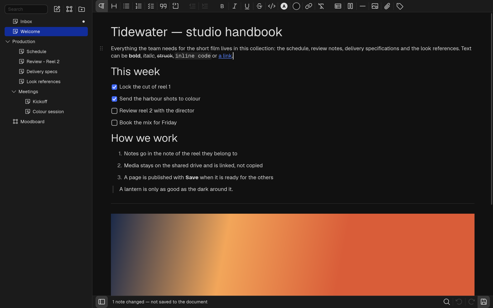

# minNotes
---

**minNotes** is a notes application for macOS and Windows, made for people
who work with footage. A **collection** is one file that holds notes, folders
and canvases in a sidebar tree. A note is made of blocks: text, lists,
tables, code, pictures, PDFs and videos you can play, write timed notes on
and draw on without leaving the page. A collection can live on a local disk
or on shared storage, and a save merges with what a colleague saved in the
meantime.

---

## What it does

### Collections, notes and folders
One `.mnd` file holds the whole tree. Make notes, folders and canvases in the
sidebar, rename them, and search the collection from the sidebar's field. See [Collections, Notes & Folders](collections.md).

### Saving that suits shared storage
Every edit is kept on your machine at once. **Save** publishes your work to
the document; if someone else saved since you opened it, the two versions are
merged block by block, and a paragraph you both changed is kept twice instead
of one being lost. See [Saving & Shared Storage](saving.md).

### Writing
Paragraphs, six levels of heading, bulleted, numbered and task lists, quotes,
dividers, columns, and code blocks coloured by language. Markdown typed as
you go is converted: `## `, `- `, `> `, `**bold**`. Text colours,
backgrounds, links and choice chips. See [Editing](editing.md) and
[Tables](tables.md) for tables with text, choice, checkmark and timecode
columns.

### Media and review
Pictures, videos, PDFs and files sit in the note as blocks. A video plays in
its block; you write notes on frames and draw on them, and those notes are
shared with [QCView](https://qcview.com). A PDF is paged in its block, its
text can be selected, and you can draw on its pages. See
[Media & Drawing](media.md).

### Canvases
A canvas is a free surface for pictures, videos, PDFs, files and the
collection's own notes as cards, with frames, a pen and shapes. See
[The Canvas](canvas.md).

### Import and export
Import Markdown, web pages, text, source code, CSV and TSV, Word, Excel and
OpenDocument files as notes. Export a note as HTML, Markdown, Word or PDF,
and a canvas as HTML or a PNG poster. See [Import](import.md) and
[Export](export.md).

### Handing work to others
A [Web Folder](web-folder.md) turns a note, a choice of notes or the whole
collection into pages for a browser, with a list of the notes, a search,
videos that play, and an optional password.
[Collect Media & Packages](packages.md) gathers a collection and the files it
refers to into one place, or one file.

---

## Get going

1. **Install.** On macOS, download the `.dmg` from the
   [releases page](https://github.com/cbkow/minNotes/releases/latest); on
   Windows, get minNotes from the
   [Microsoft Store](https://apps.microsoft.com/detail/9P2S2W9TLL9D). See
   [Installation & Updating](installation.md). If you use minNotes 2, read
   [Coming from minNotes 2](from-2.md) first: minNotes 3 does not open its
   files.
2. **Make a collection.** Choose **File > New Collection…**
   (`Option+Cmd+N` / `Ctrl+Alt+N`). An untitled collection opens at once,
   ready to type in; the first save asks where its file goes.
3. **Write.** **File > New Note** (`Cmd+N` / `Ctrl+N`) adds a note to the
   tree. Type; the toolbar over the page has the block kinds and the
   formatting. A collection you open later starts in reading: press
   `Cmd+R` / `Ctrl+R` to edit. See
   [Reading and Editing](collections.md#reading-and-editing).
4. **Add media.** Drop a picture, a video, a PDF or any other file on the
   page, or use the toolbar's **Picture** and **File** buttons.
5. **Save.** **File > Save** (`Cmd+S` / `Ctrl+S`) publishes your work to the
   document. Until then it is kept on your machine, and it is offered back
   after a crash.

Keep the [Shortcuts](shortcuts.md) page close. This manual is also inside
the application: **Help > User Guide** shows it as a folder of pages at the
foot of the sidebar, and `Cmd+/` / `Ctrl+/` opens its Keyboard Shortcuts
page.

minNotes is free software under the
[GNU General Public License](https://github.com/cbkow/minNotes/blob/main/LICENSE);
what ships with it is listed under [Licenses & Credits](licenses.md). It has
no accounts and sends no usage data: see [Privacy](privacy.md).
