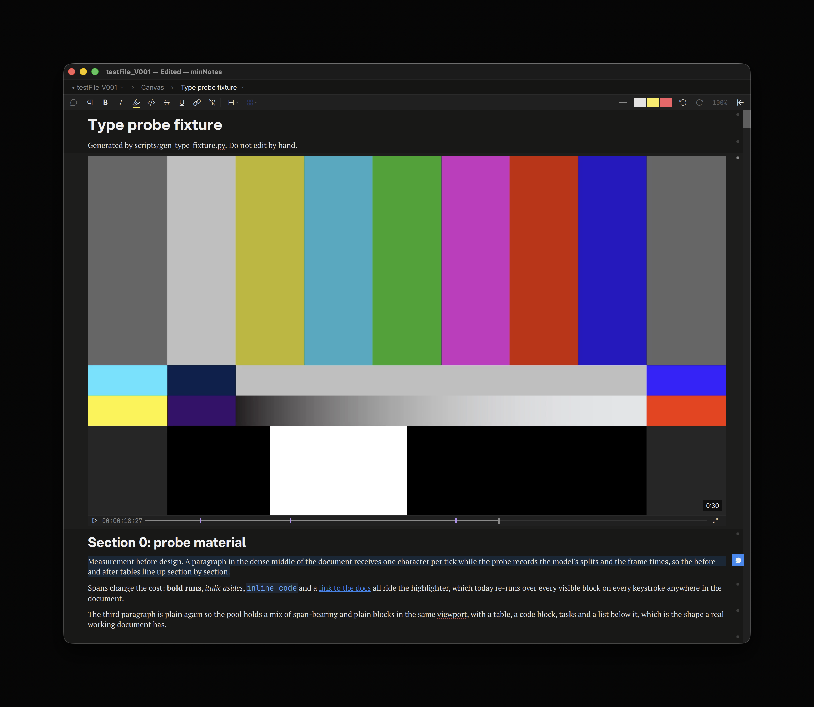

# minNotes
---



**minNotes** is a fast notes editor for macOS and Windows built around a
canvas. A file is an infinite canvas; **pages** sit on it as cards beside
videos, PDFs, images, audio, folders, files and links, and you can draw
anywhere. Each page is a block editor with Markdown-style input. Files are
plain SQLite (`.mnd`) you can keep anywhere — local disk, a network share,
Dropbox, LucidLink — and open on either platform without the file-locking
trouble shared storage usually brings.

---

## Key Features

### The Canvas
- Any number of pages per file, laid out however you like; double-click a
  page to open it
- Drop anything: video, PDF, images, audio, folders, files, links, other
  minNotes files, Evernote and Notion exports — each becomes a card
- Video plays in place with the full transport keys; PDFs page in place;
  images open in a lightbox in exports
- Pen, shapes, arrows and text chips with live colour and width; select,
  move, duplicate, reorder; one undo per surface

### Writing
- Block editor — paragraphs, headings 1–6, quotes, syntax-highlighted code,
  bullet / numbered / task / choice lists, dividers
- Markdown-style input: type `## `, `- `, `> `, ` ``` ` and the block
  converts as you go
- Inline formatting with text colour and highlight, links, and inline
  choice chips (To do / Doing / Done anywhere in text)
- Spelling and grammar checking as you type — on-device, US and UK English
  both accepted
- Pages are the width of the window, with an optional readable measure
- Blocks side by side: drag any block next to another to make lanes
- A block rail down the right side — drag a block's handle to reorder
- Full undo history: the page's timeline, click to time-travel
- Search the whole file: pages, cards, PDF text, video notes

### Tables
- Cells hold blocks — text, formatting, images, video; choice, checkmark,
  and timecode columns
- Grip-select rows, columns, or cell ranges for bulk operations —
  delete, clear, colour, retype, copy-as-table — each a single undo
- Sort, drag-reorder columns, a tab per table with a row filter
- One-click kanban board view grouped by any choice or check column

### Media & Review
- Inline images, video (scrub, skim audio, annotate — interchangeable with
  [QCView](https://qcview.com)), page-by-page PDFs, file attachments
- Local files copy into the file's media folder automatically; network
  shares stay referenced in place, with cross-OS path mapping

### Files
- Import: Markdown, text, CSV/TSV, HTML, Word, Excel, OpenDocument,
  source code, RTF (macOS), Evernote, Notion
- Export a page as Markdown + assets, a self-contained HTML page, Word,
  or print-ready PDF; export the whole
  canvas as an HTML canvas you can pan and zoom, or a PNG poster
- Sealed `.mnpkg` packages — one file with every referenced asset inside,
  video plays straight from the archive

---

## Get Going

1. **Download** the latest `.dmg` (macOS) or `.exe` (Windows) from the
   [releases page](https://github.com/cbkow/minNotes/releases/latest) —
   see [Installation](installation.md).
2. Open or create a file, then start with [Files & Pages](basics.md), the
   [Canvas](canvas.md) tour and the [Editing](editing.md) primer.
3. Keep the [Keyboard shortcuts](shortcuts.md) close.

minNotes is free software, licensed
[GPL-3.0-or-later](https://github.com/cbkow/minNotes/blob/main/LICENSE).
Third-party components and their licenses are listed under
[Licenses & Credits](/licenses/).
It runs entirely on your machine — see [Privacy](privacy.md).
