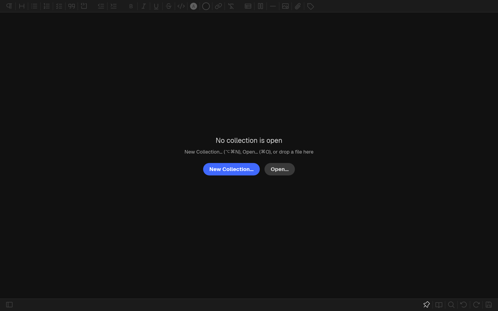

# Installation & Updating

| Platform | Where |
|---|---|
| macOS 13 or later, Apple silicon | A `.dmg` from the [releases page](https://github.com/cbkow/minNotes/releases/latest) |
| Windows | The [Microsoft Store](https://apps.microsoft.com/detail/9P2S2W9TLL9D) |

## macOS

1. Download the `.dmg` from the
   [releases page](https://github.com/cbkow/minNotes/releases/latest) of the
   minNotes repository on GitHub.
2. Open it and drag **minNotes** to Applications.
3. Start minNotes.

minNotes needs macOS 13.0 or later and a Mac with Apple silicon.

The first window says "No collection is open" and has two buttons,
**New Collection…** and **Open…**. You can also drop a collection, a
package or any other file on it. [Collections, Notes & Folders](collections.md)
goes on from there.

### Updates

minNotes checks for a new version by itself, once a day, and shows a window
when there is one. To check now, choose **minNotes > Check for Updates…**.

The check reads the update feed at `minnotes.app` and nothing else. See
[Privacy](privacy.md).

### If minNotes 2 is installed

minNotes 3 has the same name and the same identity as minNotes 2. Dragging it
to Applications replaces minNotes 2, and a minNotes 2 that updates itself is
offered minNotes 3 as its next version.

**Note:** minNotes 3 imports the pages of a minNotes 2 document into a new
collection rather than opening the document; some things are left behind.
Read [Coming from minNotes 2](from-2.md) before you replace it.

## Windows

Install minNotes from the
[Microsoft Store](https://apps.microsoft.com/detail/9P2S2W9TLL9D). The Store
is the only place minNotes for Windows comes from: there is no separate
installer to download. The Store delivers the updates too; on Windows
minNotes does not check for them itself.

If minNotes 2 is installed from the Store, minNotes 3 arrives as its
update. Read [Coming from minNotes 2](from-2.md) first.

On Windows the menus are a bar at the top of the window, with **Exit**
under **File** and **Licenses…** under **Help**; see
[The menu bar on Windows](collections.md#the-menu-bar-on-windows).

## Opening a collection from outside minNotes

minNotes has two kinds of file of its own:

| File | What it is |
|---|---|
| `.mnd` | A [collection](collections.md): its notes, folders and canvases in one file |
| `.mnpkg` | A [package](packages.md): a collection and its media in one file |

On macOS you can open either without going through **File > Open…**:

- Double-click the file in Finder, or use **Open With**.
- Follow an address of the form `minnotes:///path/to/Tidewater.mnd`. Another
  application can use such an address to open a collection in minNotes.

If minNotes is already running, the collection opens in the window you have.
It takes the place of the collection that was open there, and minNotes asks
first about changes that are not yet saved to that one. Handing over the
collection that is already open does nothing.

A package is not opened as it is. minNotes asks for a folder, unpacks the
package into it and opens the unpacked collection. See
[Collect Media & Packages](packages.md).

[QCView](https://qcview.com) 3.0.3 and later hands minNotes two more things:

- **Export to minNotes…** gives a place for a collection and a clip. minNotes
  opens that collection, or makes it when nothing is there, adds a note with
  the clip's name as its heading and the video under it, and saves.
- **Open in minNotes** on a live stream gives the folder of the stream's
  notes. minNotes makes a collection in that folder with one note: the
  stream's name, then each captured note with its time, its picture and its
  text.

Anything else is refused with the notice "That is not a minNotes collection
or package".

## Video export needs nothing installed

A [web folder](web-folder.md) can carry videos that play in the browser.
minNotes makes them with FFmpeg, and FFmpeg comes inside the application.
You do not install it, and an FFmpeg found elsewhere on the machine is not
used.

## Licences

Everything that ships with minNotes is listed, with its licence, under
[Licenses & Credits](licenses.md).
