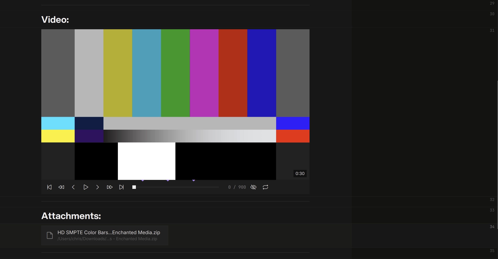
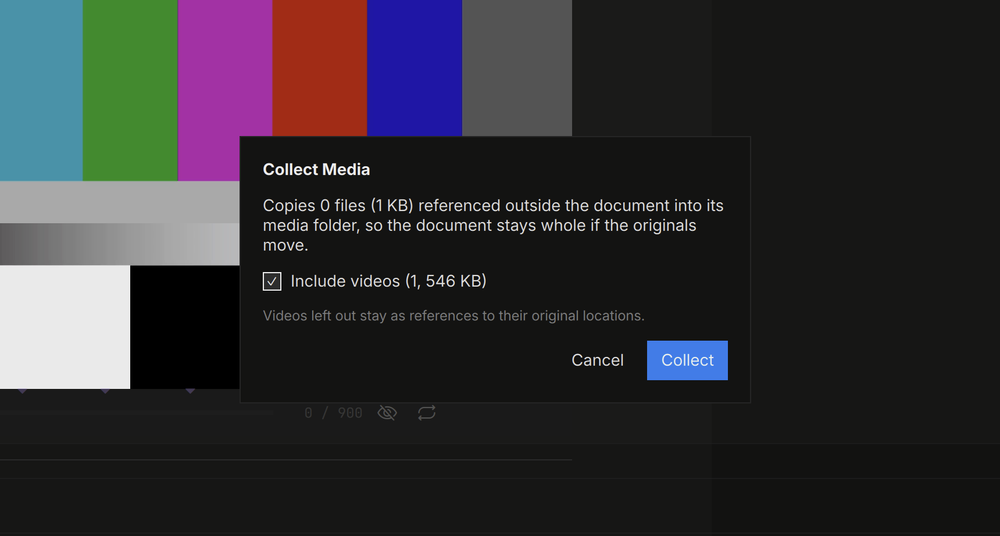
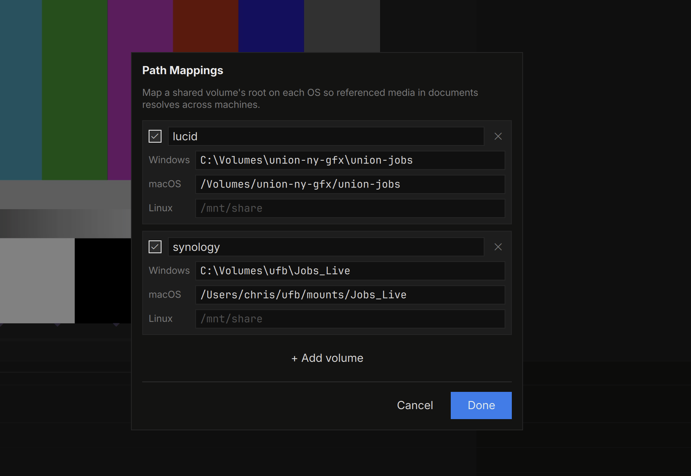

# Media & Files

Media lives in two places: **inline in a page**, as blocks, and **on the
canvas**, as cards. Drag a file into a page, or paste from the clipboard:

- **Images** — inline; hover or select one for its outline and drag any
  corner to resize. Right-click for **Fit width** and **Original size**
  (double-clicking a corner does the same). Images also live inside
  table cells.
- **Video** — an inline player with a compact transport bar: play, the
  timecode (click it to show frames), a scrub line with the clip's note
  markers, and a glyph that opens the review studio. Skim audio,
  press-and-hold fast forward / rewind, and the full transport keys while
  the video has the caret. Notes are interchangeable with
  [QCView](https://qcview.com).
- **PDF** — paged inline with prev / next; open full-frame to read and
  zoom. The PDF file is never modified.
- **Other files** — an attachment chip; double-click to reveal in Finder /
  Explorer.

Dropped on the **canvas** the same files become cards — a video that plays
in place, a PDF that pages in place, folders and bookmarks too. See
[The Canvas](canvas.md#media-on-the-canvas).

## Where Files Live

When you paste or drop a **local** file, minNotes copies it into the
file's own media folder (`.minnotes/` beside the file) — pasted
screenshots can't vanish when a capture app cleans its temp files. Files
on **network shares** stay referenced in place: no duplicate copies of
production media.

**Document ▸ Reveal Media Folder** opens the media folder.
**Document ▸ Collect Media…** pulls every externally referenced file into
it (videos opt-in), making the file self-contained — one undo step, and
the file saves itself after.

## Cross-OS Paths

Referenced media is stored as an OS-neutral reference, so a file written
on macOS resolves its NAS paths on Windows and back. Teach minNotes your
share roots once under **File ▸ Path Mappings…**:

| macOS | Windows |
|---|---|
| `/Volumes/projects` | `P:` or `\\server\projects` |

The same mapping system powers the paths printed on canvas cards and
[ufb links in exports](export.md).
