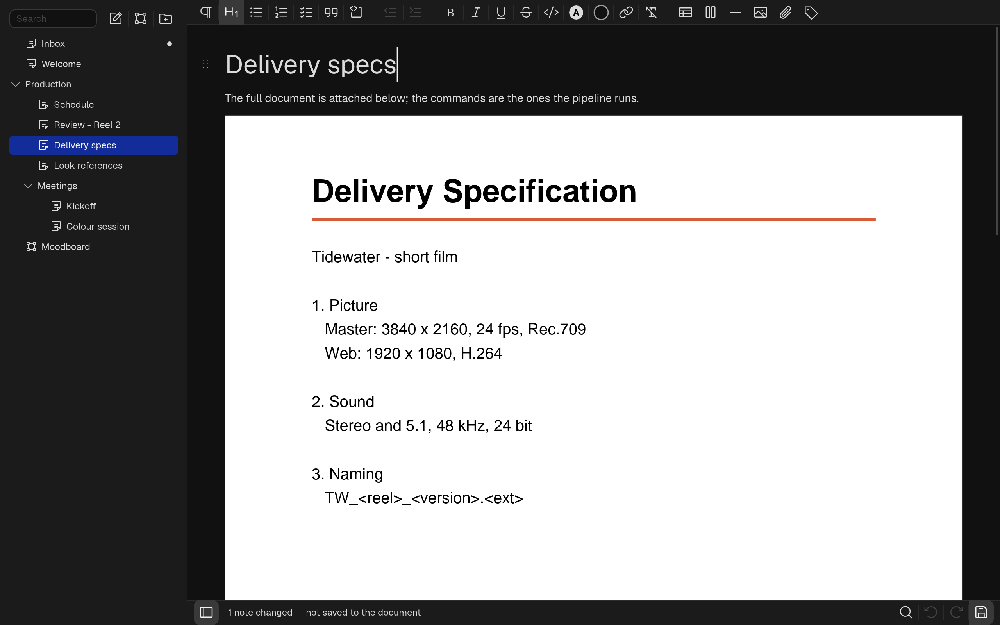
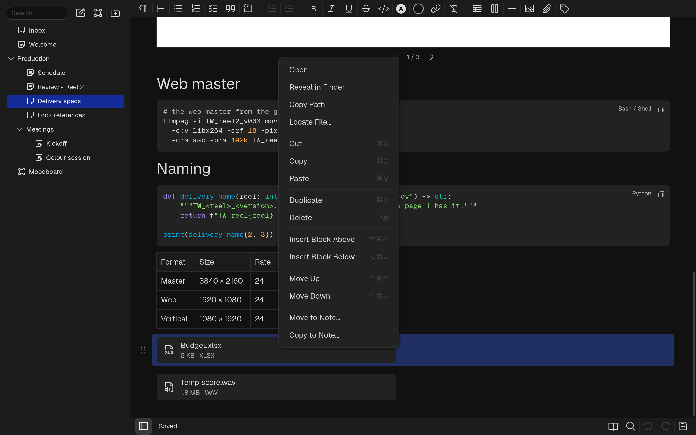
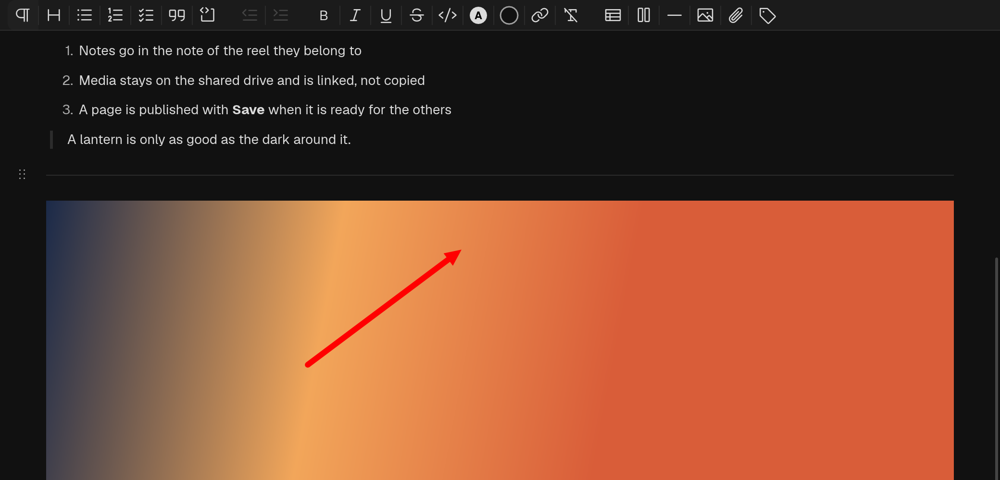

# Media & Drawing

A note can hold pictures, PDFs, videos and any other file. Each one is a
block of the note, like a paragraph or a table. You look at media, play it,
draw on it and write review notes on it **in the block itself**: there is no
separate viewer to open.

## Adding Media

- **Drop** files from the Finder or Explorer onto the note. A line shows
  where they will land, between two blocks. Several files dropped together
  are one undo step.
- Use the toolbar's **Picture** or **File** button and choose files in the
  system's dialog. They go in after the block the caret is in.
- **Paste** with `Cmd+V` / `Ctrl+V`: files copied in the Finder or Explorer,
  or a picture copied in another application (a screenshot, **Copy Image**
  in a browser).

What a file becomes depends on its kind: a picture, a PDF and a video each
get a block of their own; anything else, a folder included, becomes a file
chip.

Pictures inside text you paste from a web page, a spreadsheet or Markdown
come along with it. Each is fetched once from its address and then kept
with the collection.

**Note:** a file dropped on the note is never imported as text. To turn a
document into a note, use **File > Import…**.

## Linked, Not Copied

minNotes points at media where it lies. Videos, PDFs and file chips are
always references: nothing is duplicated, and the original is never
changed.

Pictures are the exception, so that a screenshot does not vanish with its
temporary file:

| What you add | What minNotes keeps |
|---|---|
| A picture on a local disk | A copy, in `minNotes Media/` beside the collection |
| A picture on a network share | A reference to the file where it is |
| A pasted picture, or one fetched from the web | A copy, in `minNotes Media/` |
| A Photoshop, SVG, Illustrator, HEIC or RAW file | A reference to the original, plus a PNG preview in `minNotes Media/` |
| A video, a PDF, any other file, a folder | A reference to the file where it is |

`minNotes Media/` is an ordinary, visible folder next to the `.mnd` file.
A new copy waits on your machine and is written there by the next **Save**.
If you move the collection by hand, move the folder with it.

To bring every referenced file into that folder, so the collection can
travel, use **File > Collect Media…**. See [Packages](packages.md).

## Pictures

minNotes reads PNG, JPEG, TIFF, TGA, BMP, EXR and DPX directly, and the
first frame of a GIF or WebP. A JPEG stored on its side is shown upright,
as its EXIF orientation says.

Some files are shown through a **preview** rendered from them, with a small
label in the corner naming the format:

- **PSD / PSB**: the flattened picture. The file must have been saved with
  "Maximize Compatibility".
- **SVG**: drawn at the size it is shown.
- **AI**: the first artboard, flat.
- **HEIC** and camera **RAW** (DNG, CR2, CR3, NEF, ARW, RAF, ORF, RW2, PEF,
  SRW): macOS only.

When the original changes, the preview is rendered again by itself.

A picture comes in at its own size, never wider than the page. To resize
it, click it: the current picture gets an outline and a handle at each
corner. Drag a corner. `Esc` during the drag gives it up. To go back,
right-click the picture and choose **Original Size**.

When a picture cannot be shown, its box says why:

- **Not found**, with the file's name and where it was looked for. This is
  also what you see when the file is on a volume this machine has no path
  for.
- **Cannot be shown**, with the reason, when the file is there but could
  not be read.

## PDFs

A PDF block shows one page at a time. The strip under the page has the
page number among the pages, with an arrow on each side: click the left
half of the strip for the previous page, the right half for the next. The
page a block shows is kept with the note.

Drag across the page to select text, then `Cmd+C` / `Ctrl+C` to copy it.
With the PDF block current, `Cmd+A` / `Ctrl+A` selects the whole page's
text. `Esc` lets the selection go.

## Video

A video block shows a still of the clip with its length in the corner.
Under it is a strip: a play button, the timecode of the frame, and a line
to scrub on.

- Click the picture, or press `Space` with the block current, to play and
  pause.
- Drag on the line to scrub.
- One video plays at a time. A playing video that scrolls out of view
  pauses.

The block remembers the frame it stands on. Loop, speed, volume and mute
are remembered between launches; when one of them is not as usual (a speed
other than 1, muted, not looping) the strip says so at its right end.

The timecode reads `HH:MM:SS:FF`, counted from the clip's first frame.

While a video block is current, the keyboard is the transport:

| Action | Key |
|---|---|
| Play / pause | `Space`, `K`, `W` or `S` |
| Step a frame back / forward | `Left` / `Right`, or `Q` / `E` |
| Rewind / fast forward (hold) | `J` / `L`, or `A` / `D` |
| Go to the start / the end | `Home` / `End` |
| Loop on and off | `V` |
| Cycle the review speed | `R` |
| Reset the speed | `Shift+R` |
| Mute | `M` |

`Up` and `Down` leave the block, as they do for any block.

minNotes plays the formats QCView plays, among them MOV, MP4, M4V, MXF,
MKV, AVI and WebM. The playing video is shown through the same colour
pipeline as in QCView, HDR included. A video at rest shows an SDR still.

## Other Files

Any other file is a **chip**: an icon for its kind, the name, and the size
and extension. Audio files, spreadsheets, archives and folders are all
chips. A chip always points at the file where it is.

Click a chip to select it; click it again to open the file in its own
application.

## The Media Menu

Right-click a media block for its commands, above the usual block
commands:

| Command | On | What it does |
|---|---|---|
| **Reveal in Finder** / **Show in Explorer** | Pictures, PDFs, videos, chips | Shows the file in its folder |
| **Copy Path** | Pictures, PDFs, videos, chips | Copies the file's path |
| **Open** | Chips | Opens the file in its own application |
| **Locate File…** | Chips; a picture that is not found | Points the block at the file again |
| **Original Size** | A resized picture | Removes the width you gave it |

A picture pasted from the web that has not been fetched has no file, so it
has no such rows.

## Missing Files

A file that has moved, or is on a volume that is not connected, shows as
**Not found** (a chip says **Missing**).

For a picture or a chip, right-click it and choose **Locate File…**, then
pick the file. When you relink one picture, the note's other missing
pictures that have a file of their name in the same folder are linked
with it, in the same undo step.

**File > Collect Media…** lists every file the collection refers to and
shows the missing ones, each with a way to locate it. See
[Packages](packages.md).

When files are missing because the same volume has a different path on
this machine (a share mounted as `/Volumes/projects` on macOS and `P:` on
Windows), set the volume up once under **File > Path Mappings…**. Files
on that volume are then recorded by volume, and found on both systems.
See [Packages](packages.md).

## Drawing on Pictures and PDF Pages

Click a picture or a PDF block. While it is the current block, the toolbar
shows the drawing tools in place of the text tools.

| Tool | Key | What it does |
|---|---|---|
| Pick | `V` | Picks a stroke on its line: drag to move it, `Delete` to remove it |
| Pen | `P` | Draws freehand. A tablet's pressure varies the line |
| Line | `L` | A straight line |
| Arrow | `A` | An arrow |
| Rectangle | `R` | A rectangle |
| Oval | `O` | An oval |
| Eraser | `E` | Rubs out the part of a pen line it passes over; a shape goes whole |

After the tools come the **pen colour** and the **Thinner line** /
**Thicker line** buttons. With a stroke picked, they change that stroke.
The colour and width are remembered.

Press a tool's key or button again to put it down; `Esc` does the same.
Each stroke is one undo step of the note.

A drawing belongs to the picture, or to the PDF page it was drawn on. It
scales with the block, turns with the page, and goes out with the note's
exports. The picture or PDF file itself is never changed.

## Video Review Notes

A review note belongs to **one frame** of a clip. It can hold a drawing,
words, or both.

Click a video block. The toolbar now shows, in order: select, pen, line,
arrow, rectangle, oval, eraser and **Write a note on this frame**; then
the pen colour, thinner and thicker; and at the right end **Mark the note
addressed** and **Delete the note**.

### Writing a Note

1. Go to the frame: scrub, or step with `Left` / `Right`.
2. Click **Write a note on this frame**. A field opens along the lower
   edge of the picture.
3. Type, then press `Return` / `Enter` to keep the words. `Esc` gives them
   up.

To change a note's words later, go to its frame and click the caption at
the lower edge of the picture, or click the toolbar button again.

### Drawing on a Frame

Click a drawing tool, then draw on the picture. The video pauses for it.
Drawing on a frame that has no note makes one.

With a tool armed, a click on the picture draws instead of playing. Click
the tool again to put it down.

The select tool picks a drawing: drag to move it, drag its corners to
scale it, `Delete` to remove it. `Cmd+Z` / `Ctrl+Z` and `Shift+Cmd+Z` /
`Ctrl+Shift+Z` step through the clip's drawings. That history is the
clip's own, apart from the note's.

### Finding Notes Again

- Every note is a **mark on the scrub line**. Click a mark to go to its
  frame.
- A clip with notes has a **row of small pictures** under the strip, one
  per note, each with its timecode. Click one to go to its frame; click it
  again to edit its words. The one the video stands on is outlined.
- On a note's frame, its drawing shows over the picture and its timecode
  and words along the lower edge.

### Addressed, Hidden, Deleted

- **Mark the note addressed** ticks the note the video stands on, and
  again unticks it. An addressed note carries a tick and its mark on the
  line changes colour.
- The **eye** at the right of the scrub line hides the notes' drawings and
  captions on the pictures, for every video, and shows them again. The
  marks and the row stay.
- **Delete the note** removes the note of the current frame, with its
  drawing.

### Shared With QCView

Review notes are not stored in the collection. They are kept beside the
clip, in a `.qcview` folder, in QCView's own format. Open the same clip in
[QCView](https://qcview.com) and you see the same notes and drawings;
notes written there show up in minNotes. Anyone who has the clip and that
folder has the notes.

To leave a clip's notes out of an export, untick **Export > Include Video
Notes**. See [Export](export.md).
