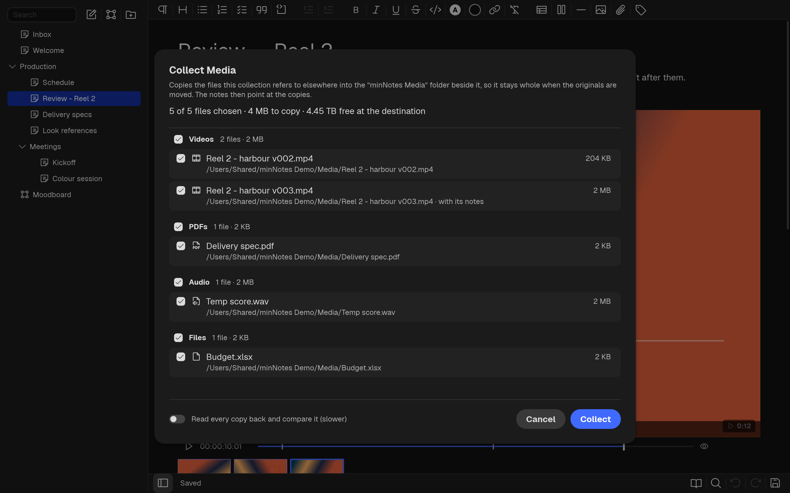
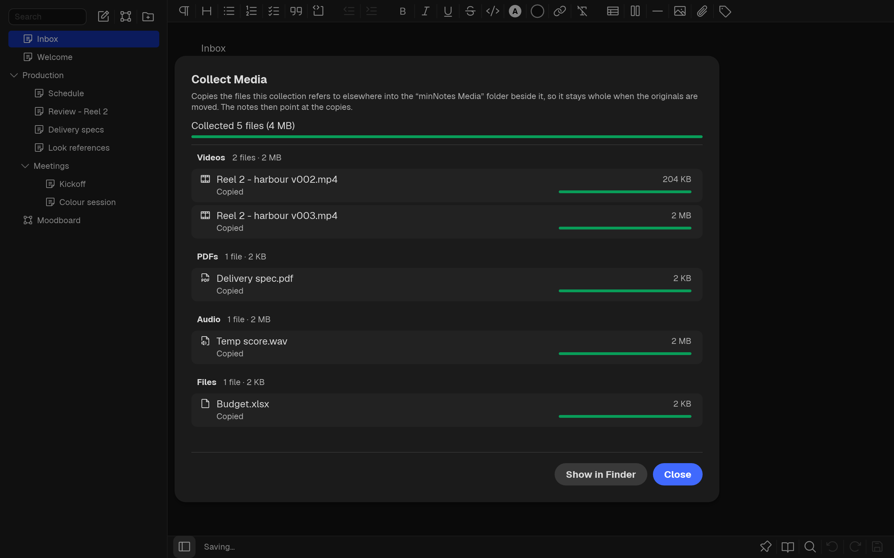
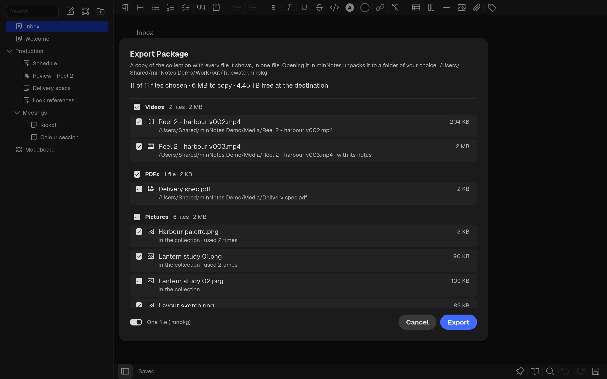
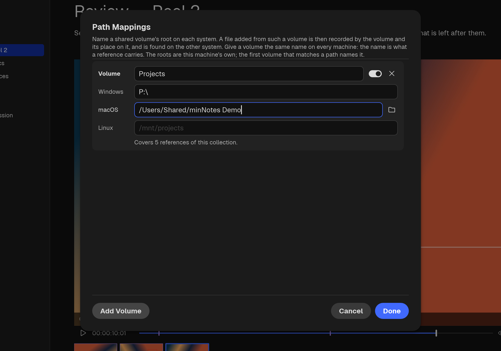

# Collect Media & Packages

A collection **links** to most of its media. A video, a PDF or an
attached file stays where it is, on your disk or on the shared volume,
and the note records where. Nothing is duplicated, and a note about a
40 GB clip stays small. Pictures you add from your own disk are the
exception: they are copied and kept with the collection.

Files kept with a collection live in a folder named **`minNotes Media`**
beside the `.mnd` file. Move the two together.

Linking is right while everyone sees the same volumes. This page covers
what to do when they do not:

- **Collect Media** copies the linked files in beside the collection.
- **Export Package** puts the collection and all its files into one file
  to hand over.
- **Path Mappings** tell each machine where a shared volume is, by the
  volume's name, so that links work on macOS and Windows alike.

## Collect Media

**File > Collect Media…** copies every file the collection's notes and
canvases refer to elsewhere into `minNotes Media`, and points the notes
at the copies. The collection then stays whole when the originals are
moved or the volume is not connected.

The window opens on a review. Nothing is copied yet.

**Note:** Collect Media and Export Package write beside the collection's
document, so a new collection that is still untitled must be saved first.
Until it is, the footer answers "Save the collection first — this is
written beside its document". See
[A new collection](saving.md#a-new-collection).

- There is a row per file, under its kind: **Videos**, **PDFs**,
  **Pictures**, **Audio**, **Files**. Each kind shows its count and
  size. A file used several times is listed and copied once.
- Each row and each kind has a **tick**. Everything is ticked at first,
  videos included. Untick what should stay linked.
- A file that is missing or cannot be read says so on its row before
  anything starts, with **Locate…** to point at it. A missing file that
  is not located is left as it is.
- A line under the list gives the size chosen and the room free at the
  destination. When it does not fit, the copy cannot start.
- A file the destination already holds, with the same name, size and
  time, is marked and not copied again.
- **Read every copy back and compare it (slower)** checks each copy
  against its original. Every copy is checked by size in any case.

A clip's review notes go with the clip. A picture made from another file,
such as a Photoshop file, has that original collected too. Folders, web
addresses and link cards are never collected.

Press **Collect**.

- Each row shows its state and its own bar: waiting, the bytes copied
  with the rate, checking, **Copied**, **Already there**, or failed with
  the reason. A bar for the whole shows files, bytes and the time left.
- A failed row has **Retry**. A failure stops nothing else.
- **Hide** puts the window away while the copy runs. The footer then
  shows the percent and the time left; click it to bring the window
  back.
- **Stop** drops the file being written and asks whether to keep what
  was copied or remove it: **Keep Them** or **Remove Them**.

The references change once, at the end, and only for files that reached
the destination. The collection is then saved at once, so the document
and its files cannot part. A line says what was done, with **Show in
Finder**.

A copy takes the file's own name. When that name is taken, it gets `-2`,
`-3` and so on.

**Note:** You cannot close the collection or quit while a copy runs. Stop
it or let it finish.

After **Save As…** to another folder, the footer tells you when files
are still referenced outside the collection, and names **Collect
Media…** as the way to bring them in.

## Export Package

**Export > Collection as Package…** writes the whole collection and every
file it shows into **one `.mnpkg` file**: the files already kept with the
collection, and the files linked elsewhere. It is the thing to send to
someone who does not have your volumes.

Name the file first. The same window then opens, with the same list and
ticks as Collect Media, and one more switch: **One file (.mnpkg)**, which
is on. The read-back check is offered for the folder form only; one file
carries a checksum for each file in it, which is checked when the package
is unpacked.

Press **Export**. The package is a copy: the collection you have open is
not changed, and its links stay as they are.

A `.mnpkg` is a zip archive. Media is stored in it as it is, not
compressed, because video and pictures do not shrink; so packing is as
fast as copying, and nothing is written twice.

- If a file fails, the rest go on. At the end minNotes asks: **Retry**
  on the failed rows, **Finish Without Them**, or **Cancel Package**.
- **Stop** removes what was written. Half a package is no package.

### A Folder Instead of One File

Turn **One file (.mnpkg)** off and the package is a **folder**: a copy
of the collection with a `minNotes Media` folder beside it. It opens in
minNotes as it is, with nothing to unpack.

Choose the folder form for very large packages on slow or unreliable
destinations. A folder can be picked up again after a stop, because
files already there are not copied again. One file cannot.

### Opening a Package

Open a `.mnpkg` with **File > Open…**, from **Open Recent**, or by
dropping it on the sidebar. A package is not opened in place. minNotes
asks for a folder, suggesting the package's name beside the package, and
**unpacks** it there. The footer shows the percent. Every file is checked
as it is unpacked.

The unpacked folder holds an ordinary collection, and it opens as soon as
the unpacking is done. You can edit it, play its videos and draw on them
as in any collection. The `.mnpkg` file is not changed and is not needed
again.

Unpacking needs room for one more copy of everything in the package.

## Path Mappings

A shared volume has a different path on every system. The same clip may
be `/Volumes/Projects/Tidewater/reel2.mov` on a Mac and
`P:\Tidewater\reel2.mov` on a Windows machine. A link recorded as one of
those plain paths is a missing file on the other machine.

A path mapping names the volume. A file added from a mapped volume is
recorded by **the volume's name and its place on it**, not by this
machine's path: the reference says "the volume Projects, then this path".
Each machine's own table says where Projects is, so every machine that
has a volume of that name finds the file. See
[Setting Up Another Machine](#setting-up-another-machine).

Choose **File > Path Mappings…**.

Each row is one volume:

| Field | What to enter |
|---|---|
| **Volume** | The volume's name, such as `Projects`. The name is what a reference carries: use the same name on every machine |
| **Windows** | The volume's root on Windows, such as `P:\` or `\\server\share` |
| **macOS** | Its root on macOS, such as `/Volumes/Projects` |
| **Linux** | Its root on Linux, such as `/mnt/projects` |

- **Add Volume** adds a row. The x button removes one. The switch on a
  row turns the volume off without removing it.
- The folder button beside this system's root lets you **choose the
  folder** instead of typing it. If the row has no name yet, it takes
  the folder's.
- A row left without a name is called by the last folder of its root
  (`Projects` for `/Volumes/Projects`).
- `Tab` and `Shift+Tab` move between the fields.
- Fill in the roots of the other systems too, as far as you know them.
  The field that matters on this machine is the one for this system; a
  row without it maps nothing here.

**The coverage hint.** Under each volume a line says how many of the open
collection's plain-path references its root on this machine covers, for
example "Covers 3 references of this collection." If it says "Covers
none of this collection's references. Is the root right?", the root is
probably mistyped.

**First match wins.** When more than one volume matches a path, the
first one in the list names it. Rows stay in the order they were added.

Press **Done**. The mappings take effect at once.

### What Happens to Existing References

When you press **Done**, references in the open collection that are plain
paths and that a volume now covers are renamed to the volume and their
place on it. The footer says how many, for example "Path mappings saved —
3 references are now named by their volume". In the open note this is
one step that you can undo.

When you change a volume's name in the window, **Done** also renames it
in the open collection's references, so they go on finding their files.
Only the open collection is renamed. Other collections, and other
machines' tables, still carry the old name, so settle the names before
many references are made.

The files themselves are not touched and nothing is copied. Only the way
the collection names them changes.

References that no volume covers stay plain paths. A plain path written
on the other system is still found when a volume's row gives both that
system's root and this one's: the path is read under this system's root.

### Where the Table Is Kept

Path mappings belong to **this machine**, not to the collection. They are
kept in a file named `mappings.json` in minNotes' settings folder:

- macOS: `~/Library/Application Support/minNotes/mappings.json`
- Windows: `%LOCALAPPDATA%\minNotes\mappings.json`

The file is read when minNotes starts and written when you press
**Done**. It does not travel with a collection, and it does not need to:
the roots are each machine's own, and the names are what machines share.

### Setting Up Another Machine

A volume is its name. A reference carries the name, and each machine
looks the name up in its own table. Two machines agree about a volume
when both have a row with the same name, letter for letter. No file has
to be copied from one machine to the other.

To give a second machine the same volumes:

1. On the first machine, open **File > Path Mappings…** and note each
   volume's name.
2. On the second machine, open **File > Path Mappings…**, press **Add
   Volume** for each one and type the same name.
3. Enter the volume's root on that machine, or choose the folder with the
   folder button. The roots are that machine's own and may differ from the
   first machine's in every way.
4. Press **Done**. With a collection open, the coverage hint under a row
   shows whether its root covers that collection's plain-path references.

A row whose name differs, even by one letter, is a different volume:
references that carry the other name are not found through it.
