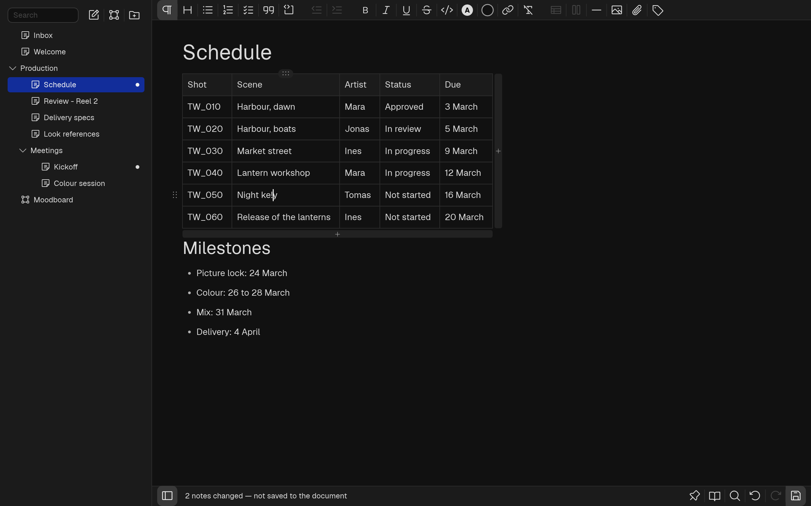
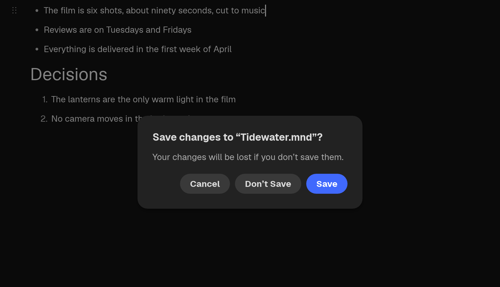

# Saving & Shared Storage

minNotes keeps two things apart:

- **Your work is kept on this machine at once.** Every edit goes into a
  private working copy of the collection in minNotes' own data folder, about
  a second after you stop typing. Nothing you type is lost to a crash or a
  dropped network drive.
- **Save publishes to the document.** The `.mnd` file itself, wherever it
  lives, is written only when you ask: **File ▸ Save** (`Cmd+S` / `Ctrl+S`),
  the Save button in the footer, or **File ▸ Save As…** (`Shift+Cmd+S` /
  `Ctrl+Shift+S`).

minNotes never works on the document where it lives. When you open a
collection it is copied to this machine and the copy is what you edit. The
document's location is touched at three moments only: when you open it, when
you save, and when you save under another name. Nothing is sent or fetched in
the background.

This is what makes a collection safe on a NAS share, an external drive or a
sync folder: a slow or missing drive cannot stall your typing, and the
document on the share is always either the old complete file or the new
complete file, never a half-written one.

## What is saved and what is not

Three places tell you where the collection stands.

- **The dot in the tree.** A note with changes that are not in the document
  yet has a dot at the end of its row in the sidebar.
- **The footer's readout**, at the left of the footer:

  | Readout | Meaning |
  |---|---|
  | Saved | The document holds everything |
  | 1 note changed — not saved to the document | Work is kept on this machine; the document does not have it yet. With more notes it reads "3 notes changed — not saved to the document" |
  | Changes not saved to the document | The same, for a change that belongs to no single note |
  | Saving… | A save is under way |
  | Saved — merged with someone else's changes | The save went through and took in a save made by someone else |
  | Save failed — your changes are kept on this machine | The document was not written; see below |

- **The Save button** in the footer is lit while something is not in the
  document yet. The window's title also carries a dot (•) then, and reads
  "saving…" while a save is under way.

Pictures you add to a note wait on this machine in the same way. The next
**Save** puts them in the `minNotes Media` folder beside the document, before
the document that names them is written.

## Closing with unsaved changes

Closing the collection, opening another one, or quitting with changes that
are not in the document asks first:

**Save changes to “Tidewater.mnd”?** Your changes will be lost if you don't
save them.

- **Save** publishes to the document, then closes. If the save fails, or a
  merge left paragraphs for you to look at, the collection stays open.
- **Don't Save** gives the changes up. The working copy on this machine is
  removed and the document stays as it is.
- **Cancel** goes back to the collection.

## When two people save the same collection

Several people can have the same collection open from a shared drive. Each
works on a copy on their own machine, so nobody blocks anybody. The copies
meet at **Save**.

When you save, minNotes checks whether the document is still the one you
opened (or last saved). If someone else has saved in the meantime, their
file is fetched, checked, **merged** with your work, and the merged result
is saved. A changed document is never overwritten.

The merge works block by block (a paragraph, a list item, a heading, a
picture, a table row are all blocks):

- A block changed by one of you keeps that person's version.
- Blocks added by either of you are kept.
- A block deleted by one of you and left alone by the other is gone. A block
  deleted by one and changed by the other stays.
- A block moved by one of you goes where that person put it; if you both
  moved it, your place stands.
- **A text block changed by both of you is kept twice**: your version first,
  theirs directly after it, marked as a conflict. There is no merging inside
  a block: two edits to the same paragraph are a conflict even when they
  touch different words.
- For a block that cannot be doubled (a media item, for example), your
  version stands.

The same rules merge the tree: notes and folders added, renamed or deleted by
either of you. Colours either of you added to the collection's palette are
kept.

### After a merge

When the merge needed nothing from you, the footer reads "Saved — merged with
someone else's changes" and that is all.

When paragraphs were changed by both of you, a dialog says so:

**The document was merged.** Someone else saved this document while you were
working. Their changes have been merged with yours. 2 paragraph(s) were
changed by both of you: both versions are kept, the second marked, for you to
choose between.

In the note, the second version of each such paragraph has a coloured bar in
the left margin. Read the two, delete the one you do not want, and save
again.

**Note:** after a merge the open note is replaced by the merged one, and its
undo history starts over.

## When a save does not go through

If the document cannot be written, nothing is written at all, and a dialog
says why:

**Couldn't save “Tidewater.mnd”**, followed by the reason and "Your changes
are kept on this machine." The reasons:

| The dialog says | What it means |
|---|---|
| it is no longer there — moved or deleted, or its drive or share is not connected | The file is missing at its location. A missing file is never taken to mean "start a new one": on a share it is as likely a drive that is not mounted |
| it cannot be reached | The location gave an error |
| its folder cannot be written to | You do not have permission to write there |
| The document's location has not answered for 20 seconds | The drive or share is not responding. It is not known whether the save went through; it is looked at again at the next Save |
| Someone else saved this document, but what is there now could not be read | The file at the location is not a collection minNotes can read |
| it keeps being saved by someone else | Other saves kept arriving while yours was being merged |

**Retry** tries again; **OK** leaves the work on this machine. The footer
reads "Save failed — your changes are kept on this machine" until a save
goes through. Reconnect the drive, or use **File ▸ Save As…** to put the
collection somewhere else.

## Opening a document that is not there

Opening a collection whose file is missing (from **Open Recent**, for
example) shows **Couldn't open “Tidewater.mnd”** and asks whether its drive
or share is connected. Nothing is created in its place.

## Recovered work

If minNotes was stopped without the question above being answered (a crash,
a power cut, a forced quit), the working copy is still on this machine. The
next time you open that collection the work is shown, with a dialog:

**Unsaved changes were found.** “Tidewater.mnd” has changes on this machine
that were never saved to the document. They are from an earlier session and
are shown now.

- **Continue with Them** keeps the changes. They are still not in the
  document until you save.
- **Discard…** asks once more ("Discard these changes?" — this cannot be
  undone), then removes them and opens the document as it is.

## Save As

**File ▸ Save As…** saves the collection at a new place, which becomes its
document from then on. The files kept in `minNotes Media` go along to the
new folder.

Files that the collection only refers to (videos, PDFs, files on a share)
stay where they are. When there are any, the footer says so after the save:
"Saved — 4 files are referenced outside the collection: File ▸ Collect
Media… brings them in". See [Media & Files](media.md).

## Working on shared storage: good habits

- **Save when you finish a piece of work**, not only at the end of the day.
  The sooner your changes are in the document, the smaller the merges for
  everyone.
- **Save before you leave a machine.** Work that is not saved is on that
  machine only; it will not be there when you open the collection elsewhere.
- **Look at marked paragraphs soon after a merge**, while you remember what
  both of you meant.
- If a share drops while you work, keep working. Save when it is back.
