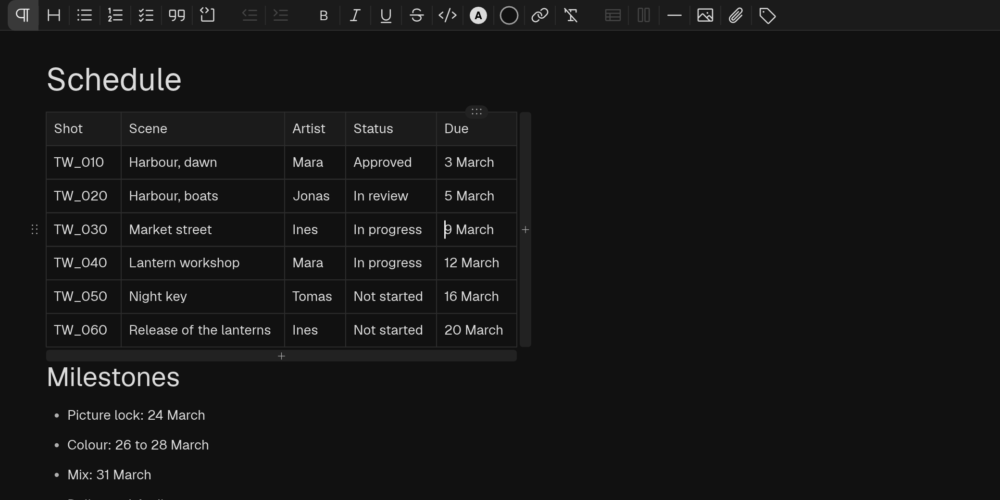
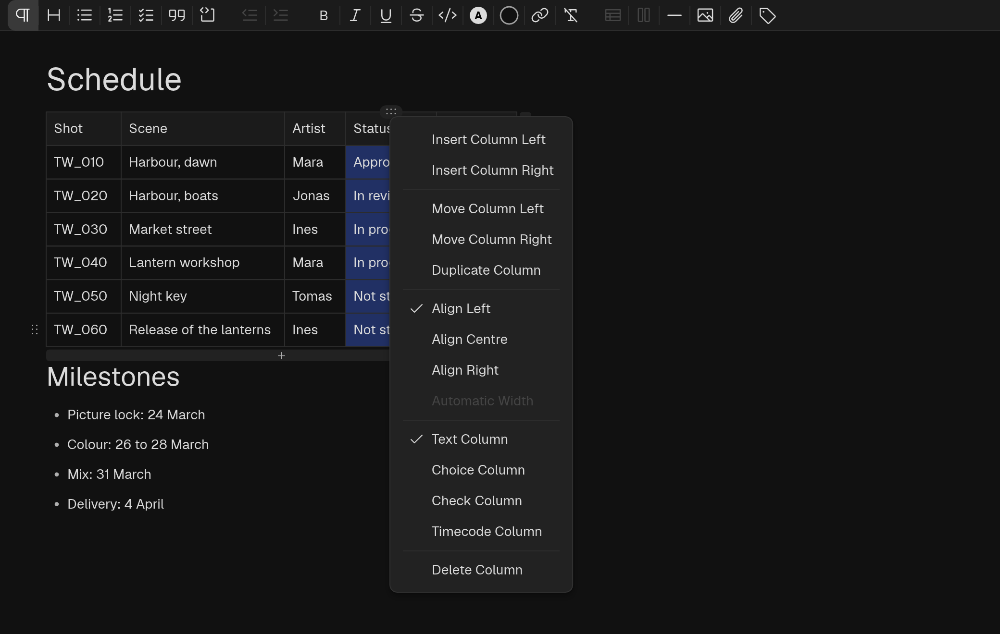
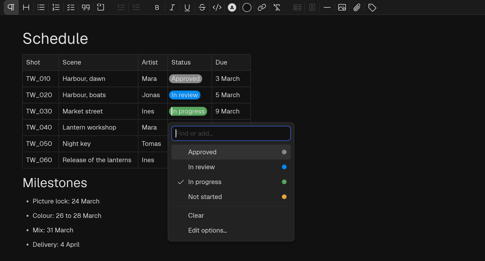

# Tables

A table is a block of rows and columns. A cell holds ordinary blocks: text
with formatting, lists, pictures. A column can also be given a kind: a
choice with coloured options, a three-state check, or a timecode at a frame
rate.

## Making a table

- Press the toolbar's **Table** button. A table of three rows and three
  columns goes in after the caret's block, its first row a header, with the
  caret in the first cell.
- Or paste rows copied from a spreadsheet (see "Pasting from a spreadsheet"
  below).
- Or import a file that holds tables; see [Import](import.md).

A table can sit at the top level of a note or inside a column. A cell does
not take another table, or columns.

## Typing and moving

| Key | Does |
|---|---|
| `Tab` | The next cell. Past the last cell, a new row is added |
| `Shift+Tab` | The cell before |
| `Enter` | A new paragraph in the same cell |
| `Cmd+Enter` / `Ctrl+Enter` | A new row below the caret's row |
| Arrow keys | Move through the text and on to the neighbouring cell |
| `Up` in the first row / `Down` in the last | When the table is the first or last block of the note, a paragraph is made above or below it and the caret goes there |

That last row is the way out of a table that starts or ends a note: keep
pressing `Up` or `Down` and you arrive in a new paragraph outside it.

## Rows and columns

The handles belong to the table the caret is in; nothing appears as the
pointer moves. With the caret in a cell you see:

- a **row handle** to the left of the caret's row,
- a **column handle** on the table's top edge over the caret's column,
- a strip **under** the table that adds a row at the end,
- a strip **beside** the table that adds a column at the end.

Click a handle to select the whole row or column and open its menu.
`Shift`-click a handle to extend the selection to that row or column
(without a menu).

**The row menu**

- **Insert Row Above**, **Insert Row Below**
- **Move Row Up**, **Move Row Down**, **Duplicate Row**
- **First Row Is a Header** / **No Header Row**
- **Delete Row**

**The column menu**

- **Insert Column Left**, **Insert Column Right**
- **Move Column Left**, **Move Column Right**, **Duplicate Column**
- **Align Left**, **Align Centre**, **Align Right**
- **Automatic Width**
- **Text Column**, **Choice Column**, **Check Column**, **Timecode Column**
  (and, by kind, **Edit Options…** or the frame rates)
- **Delete Column**

### Widths

Drag a column's right border to give it a width. **Automatic Width** in the
column menu sizes it to its content again.

A table wider than its place scrolls sideways inside its own block, with a
scroll bar of its own; the page does not move. Scroll it with a trackpad's
sideways swipe or `Shift` and the wheel.

### The header row

A table's first row can be a header, and a table may have none. Switch with
**First Row Is a Header** / **No Header Row** in the row menu.

## Column kinds

Every column starts as a text column. Choose another kind from the column
menu.

| Kind | What a cell holds |
|---|---|
| **Text Column** | Any blocks |
| **Choice Column** | One option from the column's list, shown as a coloured chip |
| **Check Column** | A box with three states: to do, doing, done |
| **Timecode Column** | A timecode at the column's frame rate |

Changing a column's kind asks first when cells would lose content, and says
how many: a cell that holds more than one line of plain text is reduced to
one line. Changing to a text column never asks.

### Choice

- Click a choice cell, or press `Space` or `Enter` in it, to open its
  picker. Typing a letter opens the picker with that letter in its field.
- The field filters the options. `Enter` on a name that does not exist adds
  it as a new option, in the next colour.
- **Clear** empties the cell; so does `Backspace` or `Delete` in the cell.
- **Edit options…** (also **Edit Options…** in the column menu) opens the
  column's list: rename, recolour, reorder, remove and add options. **Done**
  applies the whole edit as one undo step; **Cancel** drops it. Removing an
  option clears the cells that had it.
- Text pasted into a choice cell takes the option of that name, or adds a
  new one.

### Check

Click the box, or press `Space` or `Enter` in the cell, to go to the next
state: to do, doing, done, and round again. An empty cell counts as to do.

### Timecode

- Type a timecode (`01:02:15:04`) or a bare number, which is read as frames.
  It is written out as a timecode when you leave the cell or press `Enter`.
- Set the column's frame rate in the column menu: 23.976, 24, 25, 29.97, 30
  or 60 fps. A new timecode column is 24 fps. 29.97 is written as drop-frame.
- Text that does not read as a timecode is kept and shown dimmed.

## Selecting cells

- Drag from one cell to another, or hold `Shift` and press an arrow key past
  a cell's edge, to select a rectangle of cells. Inside one cell a selection
  is ordinary text.
- Click a row or column handle to select the whole row or column.

With cells selected:

| Key | Does |
|---|---|
| `Delete` or `Backspace` | Empties the selected cells. With whole rows or whole columns selected, removes them; with every row selected, removes the table |
| `Cmd+C` / `Ctrl+C` | Copies the cells |
| `Cmd+X` / `Ctrl+X` | Copies the cells and empties them |
| `Esc` | Lets the selection go |

Copied cells go to the clipboard as a small table (with their formatting,
chips and pictures) and as the tab-separated text a spreadsheet reads.

## Pasting from a spreadsheet

- **Outside a table**, rows copied from a spreadsheet paste as a new table.
- **Inside a table**, cells copied from a spreadsheet or from minNotes fill
  the table from the caret's cell rightwards and downwards. Rows are added
  as needed; columns are never added. What does not fit is left out, and the
  footer says how many columns were left out.
- A column with a kind takes the value of the pasted text: a choice column
  picks the option of that name or gains a new one.

## Deleting a table

Select all of the table's rows and press `Delete`: with every row selected,
the table itself is removed.

## Limits

- Imported tables are capped at 10,000 cells. When a file holds a larger
  table, **File ▸ Import…** asks: **First Rows** imports the rows that fit,
  **Attach File** adds the file as a chip instead, **Cancel** stops.
- There is no sorting and no row filter.
