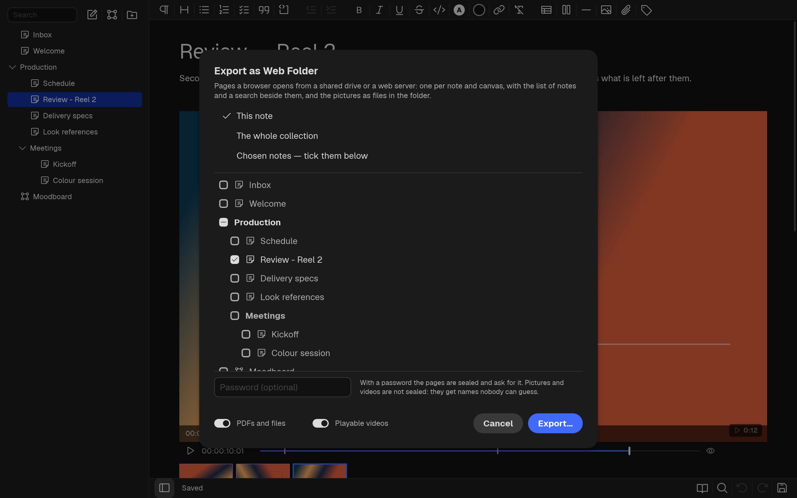
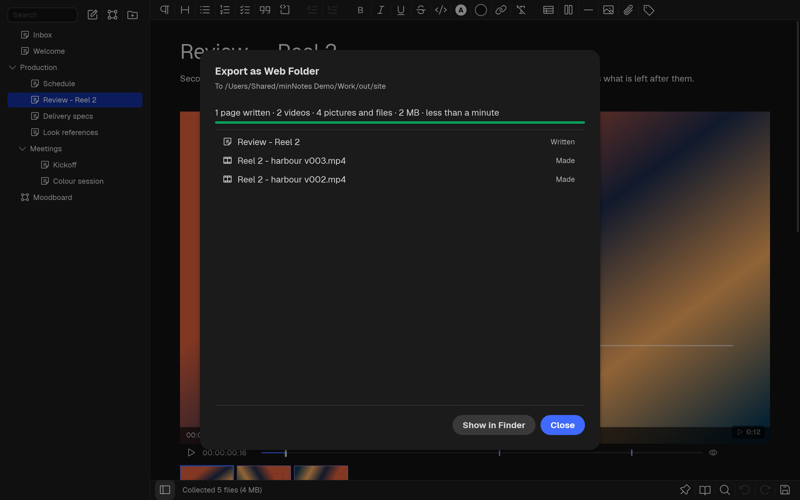
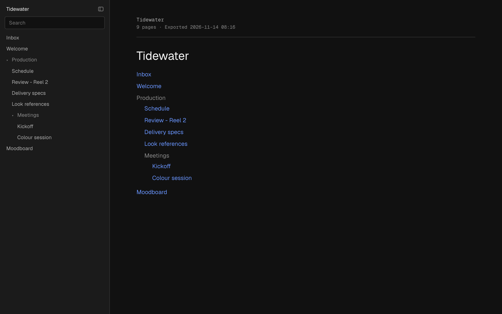
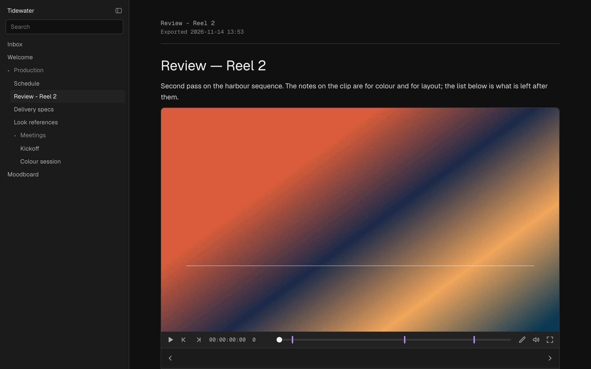

# Web Folder

A web folder is a folder of pages that any browser opens: from a shared
drive by a double click, or from a web server. It is the way to show
notes to people who do not have minNotes. It can hold one note, some
notes or the whole collection, its videos play in the page, and it can
carry a password.

The pages are read-only. Nothing a reader does in the browser comes back
to your collection.

## Exporting

Choose **Export > as Web Folder…**. A window opens over the page.

**What goes.** Choose one of three:

- **This note**: the note or canvas that is open.
- **The whole collection**: every note and canvas.
- **Chosen notes**: tick notes and canvases in the tree shown below.
  Ticking a folder ticks everything in it.

**What goes with it.**

- **PDFs and files**: PDFs and attached files are copied into the folder
  and linked from their pages. Off: they are shown by a still or a chip
  only.
- **Playable videos**: every video gets a copy the browser can play. Off:
  videos are shown as stills, as in the one-file HTML export.
- **Password (optional)**: leave it empty for none. See
  [A Password](#a-password).

Both switches are on at first. The two options of the Export menu,
**Include File Paths** and **Include Video Notes**, apply here too; see
[Export](export.md#the-two-options).

Press **Export…** and name the folder. minNotes suggests the collection's
name followed by "web", for example `Tidewater web`.

**Note:** minNotes writes only into a folder that is empty or that it
wrote as a web folder before. Any other folder is refused: "That folder
holds other things: choose an empty folder, or an earlier web folder to
replace".

### While It Is Written

The window lists the pages and marks each as it is written. The pages
come first, then the videos, one at a time, each with its share done.

You can keep working. **Hide** puts the window away; the footer then
says how far the export is, and a click there brings the window back.
**Stop** ends it: the pages written so far stay, and a video that was
being made stays a still. A stopped folder is not complete; export to it
again to finish it.

When it is done, **Show in Finder** (on Windows, **Show the Folder**)
opens the folder with `index.html` selected.

## What Is in the Folder

| Item | What it is |
|---|---|
| `index.html` | The note itself when you export one note. For several, the contents page |
| `notes/` | A page per note and per canvas, when there are several |
| `assets/` | One stylesheet with the typeface in it, and the scripts |
| `media/` | Every picture as a file, each stored once however often it is shown |
| `media/files/` | PDFs and attached files, when they are taken along |
| `media/video/` | The playable copy of each video |
| `.minnotes-export` | A marker that says minNotes wrote this folder |

Keep the folder together. The pages name their media by paths relative to
themselves, so the folder can be moved, renamed or copied anywhere as a
whole.

The marker is what lets you export into the same folder again. Then
`index.html`, `assets`, `notes` and `media` are replaced, and nothing
else in the folder is touched.

## Reading It

Open `index.html`. The pages load no data when they run, so they work
straight from a disk or a shared drive as well as from a web server. To
publish a web folder, copy the whole folder to any server that serves
plain files. Nothing has to be installed there.

- With several pages, each one carries the **list of exported notes** on
  the left, in the collection's order with its folders. Folders fold, a
  button puts the list away, and on a narrow screen it lies over the
  page. A single exported note has no list.
- A **search** field looks through the titles and the text of every
  exported note.
- A page is the note as the [HTML export](export.md#as-html) writes it:
  coloured code with its copy button, pictures in a lightbox, drawings
  as a layer you can hide with `A`.
- A **canvas** is a page too, with the sheet to drag and zoom.
- A **file's path** sits in a box with a copy button, so that a reader
  on the same network can find the real file. Untick **Include File
  Paths** before exporting to leave paths out.
- Printed, a page is light and carries no list and no buttons.

Web folders have been tested in Chrome, Firefox and Safari.

## Video

With **Playable videos** on, every video in the exported notes and on
the exported canvases gets a copy made for browsers.

- The copy is **H.264 with AAC sound in an MP4 file**, 8 bits, at the
  source's frame rate.
- Its size is the source's, reduced when needed so that the longer side
  is at most **1920 pixels**.
- A file that already is H.264 in MP4 within that size is copied as it
  is.
- The copies are made by the FFmpeg that comes with minNotes. Nothing
  else has to be installed.

**HDR and linear clips.** A video whose picture is PQ, HLG or linear
light is brought to standard range first, frame by frame, through the
same colour stage that makes its stills in minNotes. The copy looks as
the clip looks in your note, and is ordinary 8-bit H.264. This route is
much slower than the direct one, so allow time for long clips. It needs
the graphics card; without one, such a clip stays stills and the window
says why.

**Copies are kept.** A copy belongs to its source file as it was. When
you export again into the same folder, a video whose file has not changed
is not made again: its row reads "Kept from before". Only new and changed
clips take time.

### The Player

The player is the browser's own video with minNotes' controls: play, a
line to scrub on with the notes marked on it, the timecode and frame, a
frame back and a frame on, the drawings' switch, sound, and the whole
screen.

- The **caption row** under the controls shows the current note: its
  timecode, its words, and whether it is open or addressed. Away from a
  note's frame the row keeps the last note before, dimmed. A click on
  the words opens them in full. A button at each end of the row goes to
  the note before and the next note.
- The notes' **stills** stand under the caption row, the current one
  outlined. A click on a still goes to its frame.
- A note's **drawings** lie over the picture while the video stands on
  that note's frame.

With the player in focus:

| Key | Action |
|---|---|
| `Space` or `K` | Play, pause |
| `Left` or `,` | A frame back |
| `Right` or `.` | A frame on |
| `[` / `]` | The note before / the next note |
| `A` | Show or hide the drawings |
| `M` | Sound on or off |
| `F` | The whole screen |

Where a video cannot be loaded, where scripts are off, and in print, the
page shows the poster and the notes' stills instead.

## A Password

Type a password in the window before you export, and the folder's pages
are sealed.

**What is sealed.** The content of every page, the list of notes and the
text the search reads are encrypted when the folder is written. What lies
in the folder is a shell with a password box and ciphertext. Page files
get opaque names, and a browser tab shows a neutral title until the page
is opened, so the notes' titles do not leak either.

**How.** The encryption is AES-256-GCM. The key is made from the password
by PBKDF2 (HMAC-SHA-256) with 600 000 rounds. The browser decrypts the
page after the reader types the password; nothing is sent anywhere. The
browser asks once per tab session, and says so when the password is
wrong.

Over `https` and from disk the browser's own cryptography does the work.
Over plain `http` browsers do not allow that, and the page's own script
does the same work, which takes a few seconds.

### The Limits

Know these before you rely on a password.

- **Media files are not encrypted.** Pictures, videos, PDFs and attached
  files lie in the folder as they are. They get names nobody can guess,
  and only the sealed pages know the names. Whoever has the address of a
  media file can open it without the password.
- **A weak password can be guessed.** Anyone who has a copy of the
  folder can try passwords against it on their own machine, as fast as
  they like, with nothing to lock them out. The window warns under 12
  characters and does not stop you. Use a long password.
- **There is no protection on the server.** This is not a login. The
  server gives the files to anyone who asks; only the encryption stands
  between a visitor and the pages.
- **Whoever had the password keeps what they took.** Changing the
  password later does not take back pages or media already copied.
- **A forgotten password cannot be recovered.** Export again with a new
  one.
- The one-file HTML export has no password.

Exporting again to the same folder with the **same** password keeps the
videos already made. With **another** password, the media files are
renamed and the pages sealed anew, without the videos being made again.
